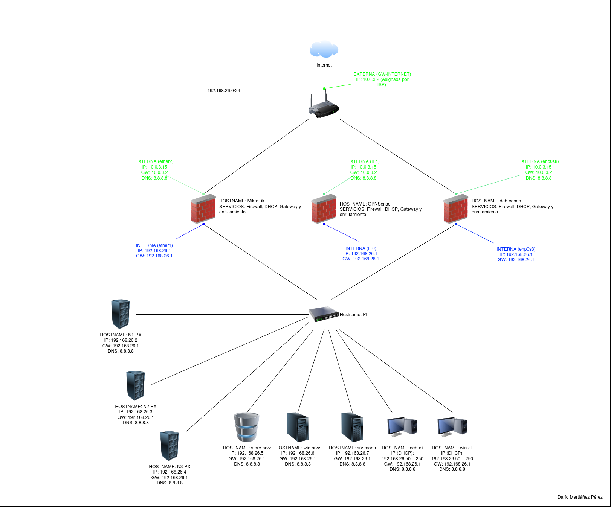

# Entorno de Pruebas Individual - Tasca 0 (ASIX ThinkLab)

| Datos de Configuración | Detalle |
| :--- | :--- |
| **Alumno** | Dario Martínez Pérez |
| **Número de PC** | PC-26 |
| **Red** | `192.168.26.0/24` |
| **Módulos** | ISO / FDM |

---

## 1. Descripción del Entorno Host

Debido a la necesidad presente de trabajar de forma flexible en distintos equipos, **el sistema operativo base y todo el entorno de pruebas se encuentran instalados en un SSD externo portátil**. Esto implica trabajar sobre un hardware anfitrión (*host*) variable en cada sesión de trabajo. 

> **Limitación de Recursos:** Dado que el equipo anfitrión menos potente utilizado por mi cuenta únicamente con **8 GB de RAM**, la asignación de memoria y recursos en la hipervisión de **VirtualBox** debe planificarse y racionarse de forma muy estricta para evitar la saturación del sistema físico.

---

## 2. Esquema de Red e Infraestructura Virtual

La arquitectura lógica de red sigue la estructura definida para el proyecto adaptada al puesto de mi PC de el aula que es el **PC-26**.

Se han configurado **tres opciones alternativas de servidores de comunicaciones/firewall** (`MikroTik`, `OPNSense` y `deb-comm`), todas conectadas por la interfaz WAN a la red NAT de VirtualBox (obteniendo IP por DHCP/red externa `10.0.3.15`) y conectadas por la interfaz LAN a la red interna virtual denominada **«PI»** con la dirección IP fija `192.168.26.1`.

> **Concurrencia de Servidores de Comunicaciones:** Actualmente, **solo se puede tener 1 servidor de comunicaciones encendido a la vez**, ya que todos comparten la misma dirección IP de puerta de enlace (`192.168.26.1`) en la red interna para facilitar la alternancia sin necesidad de reconfigurar los clientes.

---

## 3. Inventario de Máquinas Virtuales y Recursos Asignados

A continuación se detallan las características técnicas de las máquinas virtuales creadas en VirtualBox, agrupadas según la estructura organizativa del hipervisor:

### A. Servidores de Comunicaciones / Gateway (`PI (Individual)/Comm`)

| Nombre VM | Sistema Operativo | vCPU | RAM | Almacenamiento | Adaptadores de Red (VirtualBox) | Dirección IP / Rol |
| :--- | :--- | :---: | :---: | :---: | :--- | :--- |
| **MikroTik** | MikroTik RouterOS CHR v7.23.8 | 1 | 1024 MB | 128 MB (IDE) | **Adap 1:** Red Interna («PI») **Adap 2:** NAT | **LAN:** `192.168.26.1/24` **WAN:** `10.0.3.15` (DHCP) |
| **OPNSense** | FreeBSD (64-bit) | 1 | 3000 MB | 40,00 GB (IDE) | **Adap 1:** Red Interna («PI») **Adap 2:** NAT | **LAN (IE0):** `192.168.26.1/24` **WAN (IE1):** `10.0.3.15` (DHCP) |
| **deb-comm** | Debian 13 Trixie (64-bit) | 1 | 2048 MB | 20,00 GB (SATA) | **Adap 1:** Red Interna («PI») **Adap 2:** NAT | **LAN (enp0s3):** `192.168.26.1/24` **WAN (enp0s8):** `10.0.3.15` (DHCP) |

### B. Clúster de Virtualización (`PI (Individual)/Proxmox`)

| Nombre VM | Sistema Operativo | vCPU | RAM | Almacenamiento | Adaptadores de Red (VirtualBox) | Dirección IP / Rol |
| :--- | :--- | :---: | :---: | :---: | :--- | :--- |
| **N1-PX** | Debian (64-bit) / Proxmox VE | 2 | 4048 MB | 32,00 GB (SATA) | **Adap 1:** Red Interna («PI») | `192.168.26.2/24` (Nodo 1 Clúster) |
| **N2-PX** | Debian (64-bit) / Proxmox VE | 2 | 4048 MB | 32,00 GB (SATA) | **Adap 1:** Red Interna («PI») | `192.168.26.3/24` (Nodo 2 Clúster) |
| **N3-PX** | Debian (64-bit) / Proxmox VE | 2 | 4048 MB | 32,00 GB (SATA) | **Adap 1:** Red Interna («PI») | `192.168.26.4/24` (Nodo 3 Clúster) |

### C. Servidores Empresariales y de Almacenamiento (`PI (Individual)/Servers NO Comm o Proxmox`)

| Nombre VM | Sistema Operativo | vCPU | RAM | Almacenamiento | Adaptadores de Red (VirtualBox) | Dirección IP / Rol |
| :--- | :--- | :---: | :---: | :---: | :--- | :--- |
| **win-srvv** | Windows Server 2025 (64-bit) | 1 | 2048 MB | 50,00 GB (SATA) | **Adap 1:** Red Interna («PI») | `192.168.26.6/24` (Dominio/Identidades) |
| **store-srvv** | TrueNAS-SCALE-25.10.0 | 1 | 8048 MB | 20,00 GB (SATA) | **Adap 1:** Red Interna («PI») | `192.168.26.5/24` (Servidor Almacenamiento/NAS) |
| **srv-monn** | Lubuntu-26.04.1 | 2 | 2048 MB | 25,00 GB (SATA) | **Adap 1:** Red Interna («PI») | `192.168.26.7/24` (Servidor de Monitorización) |

### D. Clientes de Red (`PI (Individual)/Cli`)

| Nombre VM | Sistema Operativo | vCPU | RAM | Almacenamiento | Adaptadores de Red (VirtualBox) | Dirección IP / Rol |
| :--- | :--- | :---: | :---: | :---: | :--- | :--- |
| **win-cli** | Windows 11 (64-bit) | 2 | 4096 MB | **Disco 0:** 80,00 GB **Disco 1:** 10,00 GB | **Adap 1:** Red Interna («PI») | `192.168.26.50-250` (DHCP) (Cliente Windows) |
| **deb-cli** | Debian 13 Trixie (64-bit) | 1 | 2048 MB | 20,00 GB (SATA) | **Adap 1:** Red Interna («PI») | `192.168.26.50-250` (DHCP) (Cliente Linux/Informática) |

---

## 4. Registro de Incidencias Técnicas y Soluciones

### Incidencia 1: Gestión de recursos con equipos anfitriones limitados ($8\text{ GB}$ de RAM)
- **Síntoma / Problema:** Al trabajar en maquinas poco potentes (con un límite físico de $8\text{ GB}$ de RAM), la ejecución simultánea de máquinas virtuales provocaba una severa ralentización o falta de memoria en el *host*.
- **Causa:** La suma total de memoria reservada para el conjunto de las VMs supera con creces el límite de los equipos anfitriones más modestos.
- **Solución:** Se estableció una política estricta de arranque modular y secuencial. Las VMs se encienden únicamente por lotes según la prueba específica que se esté realizando, racionando y optimizando la memoria disponible en cada sesión.

### Incidencia 2: Concurrencia en los Servidores de Comunicaciones
- **Síntoma / Problema:** Conflicto de direcciones IP de puerta de enlace en la red interna («PI») al intentar mantener activos varios gateways de manera simultánea.
- **Causa:** Los tres servidores de comunicaciones (`MikroTik`, `OPNSense` y `deb-comm`) están configurados por diseño para utilizar la misma dirección IP (`192.168.26.1`).
- **Solución:** Actualmente, **solo se permite tener un (1) servidor de comunicaciones encendido a la vez**. Es obligatorio apagar el gateway activo antes de iniciar cualquiera de las otras dos opciones.