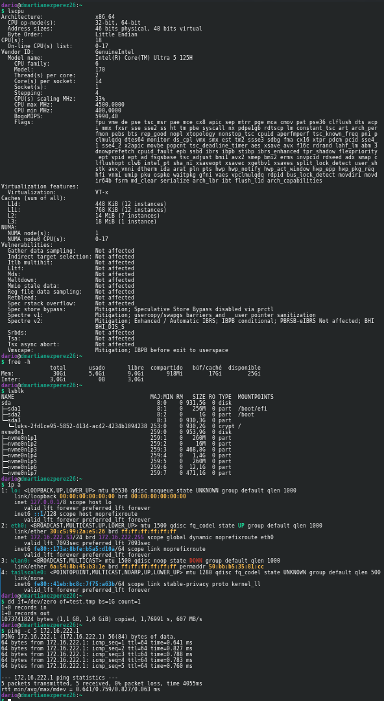
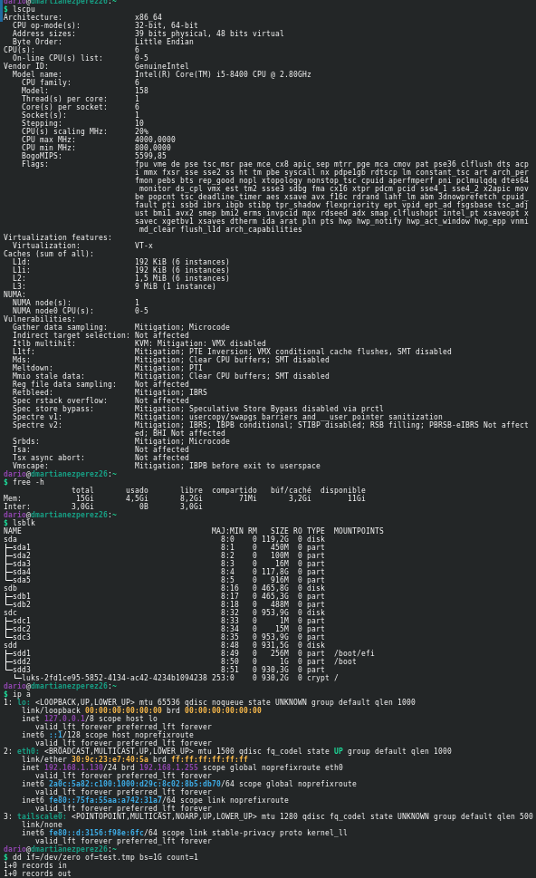
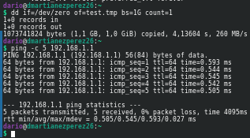

# Inventario de Hardware y Análisis de Rendimiento - Tasca 2 (ASIX ThinkLab)

| Datos de Configuración | Detalle |
| :--- | :--- |
| **Alumno** | Darío Martiáñez Pérez |
| **Número de PC** | PC-26 |
| **Red** | `192.168.26.0/24` / `192.168.1.0/24` |
| **Módulos** | ISO / FDM |

---

## 1. Descripción del Entorno Host

Para la realización de la presente actividad y las pruebas prácticas del proyecto individual, se analiza y compara el comportamiento de la infraestructura sobre dos equipos anfitriones (*host*) distintos: el equipo del aula de clase (**PC-26**) y el equipo personal de casa.

Al igual que se especificó en la Tasca 0, **el sistema operativo base y todo el laboratorio se ejecutan directamente desde un SSD externo portátil**. Esto garantiza la portabilidad completa entre el aula y el entorno doméstico.

> **Almacenamiento del Host:** Pese a que el equipo de clase cuenta con un disco interno de alto rendimiento (**NVMe de $953,9\text{ GB}$**), este **no se utiliza para nada**, ya que el sistema operativo anfitrión y el hipervisor se ejecutan íntegramente desde la unidad SSD externa en ambos puestos de trabajo.

---

## 2. Inventario Comparativo de Recursos Físicos

A continuación se detallan los datos técnicos de hardware recopilados en directo sobre ambos equipos utilizando comandos nativos del sistema Linux (`lscpu`, `free -h`, `lsblk`, `ip a`, `dd`, `ping`):

| Componente / Métrica | Equipo Anfitrión (Clase - PC-26) | Equipo Anfitrión (Casa) |
| :--- | :--- | :--- |
| **Procesador (CPU)** | Intel(R) Core(TM) Ultra 5 125H | Intel(R) Core(TM) i5-8400 CPU @ 2.80GHz |
| **Núcleos / Hilos** | 14 núcleos / 18 hilos (Arquitectura híbrida) | 6 núcleos / 6 hilos |
| **Virtualización** | Soportada e integrada (`VT-x`) | Soportada e integrada (`VT-x`) |
| **Memoria RAM Total** | $30\text{ GiB}$ ($\approx 32\text{ GB}$) | $15\text{ GiB}$ ($\approx 16\text{ GB}$) |
| **Memoria Swap** | $3,0\text{ GiB}$ | $3,0\text{ GiB}$ |
| **Almacenamiento Interno (Sin uso)** | `nvme0n1` ($953,9\text{ GiB}$) + `sda` ($931,5\text{ GiB}$) | `sda` ($119,2\text{ GiB}$) + HDDs secundarias (`sdb`, `sdc`, `sdd`) |
| **Rendimiento E/S (`dd`)** | $\approx 607\text{ MB/s}$ (sobre el SSD externo) | $\approx 260\text{ MB/s}$ (sobre el SSD externo) |
| **Interfaz / IP Red Física** | `eth0` (`172.16.222.53/24`) | `eth0` (`192.168.1.130/24`) |
| **Latencia Red Gateway (`ping`)** | $0,759\text{ ms}$ (promedio, 0% pérdidas) | $0,545\text{ ms}$ (promedio, 0% pérdidas) |

### Evidencias de Terminal (Capturas de Ejecución)

* **Ejecución en el equipo de Clase (PC-26):**
  > 

* **Ejecución en el equipo personal de Casa (Parte 1 - CPU, RAM, Discos y Red):**
  > 

* **Ejecución en el equipo personal de Casa (Parte 2 - Pruebas `dd` y `ping`):**
  > 

---

## 3. Diagnóstico de Rendimiento y Análisis de Cuellos de Botella

Para fundamentar técnicamente el comportamiento de las máquinas virtuales en cada hardware, se han ejecutado pruebas empíricas cuantitativas de almacenamiento y conectividad:

### A. Rendimiento de E/S de Almacenamiento (`dd`)
- **Comando ejecutado:** `dd if=/dev/zero of=test.tmp bs=1G count=1`
- **Resultado PC-26 (Clase):** Transferencia de $1,0\text{ GiB}$ completada en $1,76991\text{ s}$, alcanzando **$607\text{ MB/s}$**.
- **Resultado Equipo de Casa:** Transferencia de $1,0\text{ GiB}$ completada en $4,13604\text{ s}$, alcanzando **$260\text{ MB/s}$**.
- **Análisis:** La controladora y la interfaz USB/SATA del equipo de clase permiten exprimir más del doble de tasa de transferencia de la unidad SSD externa respecto al equipo de casa, acelerando el arranque simultáneo de las MVs.

### B. Pruebas de Estabilidad de Red (`ping`)
- **Comando ejecutado:** `ping -c 5 <gateway>`
- **Resultado PC-26 (Clase):** $0,759\text{ ms}$ promedio de latencia hacia `172.16.222.1` con 0% de paquetes perdidos.
- **Resultado Equipo de Casa:** $0,545\text{ ms}$ promedio de latencia hacia `192.168.1.1` con 0% de paquetes perdidos.
- **Análisis:** Ambos entornos cuentan con una capa física de red perfectamente estable sin congestión de tráfico.

---

## 4. Registro de Incidencias Técnicas y Soluciones

### Incidencia 1: Saturación de RAM en el equipo de casa ($16\text{ GB}$)
- **Síntoma / Problema:** Ralentización severa y consumo elevado de la partición Swap en el anfitrión al arrancar varios servicios del laboratorio en casa.
- **Causa:** El equipo de casa dispone de $15\text{ GiB}$ de RAM física disponibles. La suma acumulada de la plantilla completa de VMs (clúster Proxmox, TrueNAS, gateways y clientes) excede ampliamente los $16\text{ GB}$.
- **Solución:** Se mantiene la política estricta de arranque modular implantada en la Tasca 0. En casa no se ejecutan todas las MVs a la vez, encendiendo únicamente las imprescindibles para la prueba puntual que se esté realizando.

### Incidencia 2: Subaprovechamiento del almacenamiento interno en la máquina del aula
- **Síntoma / Problema:** Posible duda sobre la falta de espacio en la unidad de pruebas externa al almacenar snapshots o archivos pesados en la máquina del aula.
- **Causa:** El disco NVMe interno del PC-26 ($953,9\text{ GB}$) no se utiliza para nada por requerimiento de portabilidad del entorno en SSD externo.
- **Solución:** Centralizar la gestión de limpieza de archivos temporales (`.tmp`) e imágenes ISO obsoletas directamente en la unidad externa para no depender en ningún momento de las unidades internas del aula.