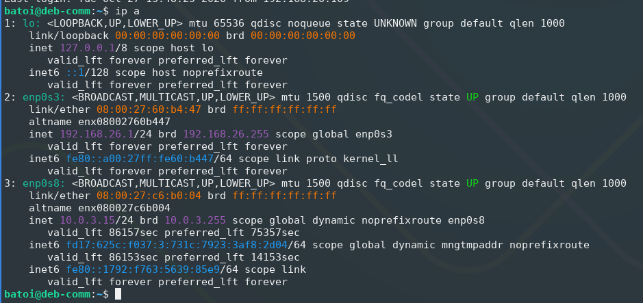
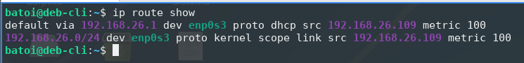
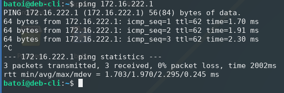
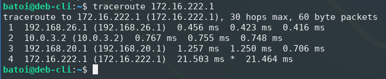

# Diseño Físico y Lógico del Sistema - Tasca 4 (ASIX ThinkLab)

| Datos de Configuración | Detalle |
| :--- | :--- |
| **Alumno** | Darío Martiáñez Pérez |
| **Número de PC** | PC-26 |
| **Red Interna (LAN)** | `192.168.26.0/24` |
| **Módulos** | ISO / FDM |

---

## 1. Descripción General de la Arquitectura de Red

El presente documento recoge el diseño físico y lógico de la infraestructura de pruebas del departamento de informática, adaptado al puesto de trabajo asignado (**PC-26**). 

La red se estructura alrededor de un conmutador virtual central (identificado como **«PI»** en VirtualBox mediante una *Red Interna*), que conecta todos los servidores y clientes del sistema con el servidor de comunicaciones/firewall.

### A. Política de Servidores de Comunicaciones Alternativos
Tal y como se ha definido en las fases anteriores del proyecto, se dispone de **tres servidores de comunicaciones alternativos** (`MikroTik`, `OPNSense` y `deb-comm`):
- **Interfaz WAN:** Conectada a la red externa de clase/NAT (`10.0.3.0/24`), obteniendo su IP de pasarela por DHCP (`10.0.3.15`).
- **Interfaz LAN:** Conectada a la red interna «PI», configurada de forma estática con la IP fija **`192.168.26.1/24`**.
- **Concurrencia:** Dado que las tres pasarelas emplean exactamente la misma dirección IP interna para no tener que reconfigurar el resto de la red, **solo se puede mantener encendido un (1) servidor de comunicaciones de forma simultánea**.

---

## 2. Esquema de Red y Topología

El esquema lógico y físico completo de la red implementada en el laboratorio se almacena en la ruta de proyectos del entorno:
- **Archivo del diagrama:** `diagrams/EsquemaM3VBOX.drawio.png`
- **Resumen de rutas:** El tráfico interno de la LAN (`192.168.26.0/24`) se conmuta directamente a través del equipo de red virtual «PI», mientras que el tráfico hacia el exterior se enruta a través de la interfaz WAN activa del firewall correspondiente.

---

## 3. Tabla de Máquinas y Recursos Asignados

A continuación se detalla la planificación y dimensionamiento técnico de todos los elementos que componen la arquitectura virtualizada del sistema:

| Host / Entorno | Nombre VM | Función Principal | Sistema Operativo | vCPU | RAM | Almacenamiento | Red / Adaptadores | Direccionamiento IP / Rol |
| :--- | :--- | :--- | :--- | :---: | :---: | :--- | :--- | :--- |
| **Comm** | `MikroTik` | Firewall / Gateway | MikroTik RouterOS CHR v7.23.8 | 1 | 1024 MB | 128 MB (IDE) | **Adap 1:** Red Interna («PI»)<br />**Adap 2:** NAT | **LAN:** `192.168.26.1/24`<br />**WAN:** `10.0.3.15` (DHCP) |
| **Comm** | `OPNSense` | Firewall / Gateway | FreeBSD (64-bit) | 1 | 3000 MB | 40,00 GB (IDE) | **Adap 1:** Red Interna («PI»)<br />**Adap 2:** NAT | **LAN:** `192.168.26.1/24`<br />**WAN:** `10.0.3.15` (DHCP) |
| **Comm** | `deb-comm` | Firewall / Gateway | Debian 13 Trixie (64-bit) | 1 | 2048 MB | 20,00 GB (SATA) | **Adap 1:** Red Interna («PI»)<br />**Adap 2:** NAT | **LAN:** `192.168.26.1/24`<br />**WAN:** `10.0.3.15` (DHCP) |
| **Proxmox** | `N1-PX` | Nodo 1 Clúster PVE | Debian / Proxmox VE | 2 | 4048 MB | 32,00 GB (SATA) | **Adap 1:** Red Interna («PI») | `192.168.26.2/24` (Nodo Clúster) |
| **Proxmox** | `N2-PX` | Nodo 2 Clúster PVE | Debian / Proxmox VE | 2 | 4048 MB | 32,00 GB (SATA) | **Adap 1:** Red Interna («PI») | `192.168.26.3/24` (Nodo Clúster) |
| **Proxmox** | `N3-PX` | Nodo 3 Clúster PVE | Debian / Proxmox VE | 2 | 4048 MB | 32,00 GB (SATA) | **Adap 1:** Red Interna («PI») | `192.168.26.4/24` (Nodo Clúster) |
| **Servers** | `win-srvv` | Control de Dominio / Identidades | Windows Server 2025 | 1 | 2048 MB | 50,00 GB (SATA) | **Adap 1:** Red Interna («PI») | `192.168.26.6/24` (Directorio Activo) |
| **Servers** | `store-srvv` | Almacenamiento / Copias | TrueNAS-SCALE-25.10.0 | 1 | 8048 MB | 20,00 GB (SATA) | **Adap 1:** Red Interna («PI») | `192.168.26.5/24` (NAS / Backup) |
| **Servers** | `srv-monn` | Monitorización sistemas | Lubuntu-26.04.1 | 2 | 2048 MB | 25,00 GB (SATA) | **Adap 1:** Red Interna («PI») | `192.168.26.7/24` (Grafana / Zabbix) |
| **Clients** | `win-cli` | Cliente Administrativo | Windows 11 (64-bit) | 2 | 4096 MB | **D0:** 80 GB / **D1:** 10 GB | **Adap 1:** Red Interna («PI») | `192.168.26.50-250` (DHCP) |
| **Clients** | `deb-cli` | Cliente Informática | Debian 13 Trixie (64-bit) | 1 | 2048 MB | 20,00 GB (SATA) | **Adap 1:** Red Interna («PI») | `192.168.26.50-250` (DHCP) |

---

## 4. Verificación de Conectividad y Enrutamiento (Apto+)

Para cumplir con los requisitos de ampliación y garantizar el correcto funcionamiento del entorno virtualizado, se han llevado a cabo las siguientes comprobaciones técnicas y recabado evidencias en vivo sobre las máquinas de la red:

### A. Configuración de Interfaces de Red (`ip a`)
En el servidor de comunicaciones activo (`deb-comm`), se verifica la correcta configuración dual de la red: la interfaz de la LAN (`enp0s3`) asignada estáticamente a la IP `192.168.26.1/24` y la interfaz WAN (`enp0s8`) vinculada por DHCP a la subred `10.0.3.15/24`.



```bash
$ ip a
1: lo: <LOOPBACK,UP,LOWER_UP> mtu 65536 qdisc noqueue state UNKNOWN group default qlen 1000
    inet 127.0.0.1/8 scope host lo
2: enp0s3: <BROADCAST,MULTICAST,UP,LOWER_UP> mtu 1500 qdisc fq_codel state UP group default qlen 1000
    inet 192.168.26.1/24 brd 192.168.26.255 scope global enp0s3
3: enp0s8: <BROADCAST,MULTICAST,UP,LOWER_UP> mtu 1500 qdisc fq_codel state UP group default qlen 1000
    inet 10.0.3.15/24 brd 10.0.3.255 scope global dynamic noprefixroute enp0s8
```

### B. Comprobación de la Tabla de Enrutamiento (`ip route`)
En el cliente de pruebas (`deb-cli`), se confirma la obtención dinámica de IP vía DHCP (`192.168.26.109`) en el segmento `.50-.250` de la LAN, comprobando que la pasarela por defecto (`default via`) apunta directamente a la IP `192.168.26.1`.



```bash
$ ip route show
default via 192.168.26.1 dev enp0s3 proto dhcp src 192.168.26.109 metric 100 
192.168.26.0/24 dev enp0s3 proto kernel scope link src 192.168.26.109 metric 100
```

### C. Pruebas de Conectividad hacia el Exterior (`ping`)
Comprobación de la salida efectiva hacia la red exterior y el router de enlace (`172.16.222.1`) desde el cliente interno `deb-cli`, garantizando un 0% de pérdida de paquetes a través de la NAT del firewall.



```bash
$ ping 172.16.222.1
PING 172.16.222.1 (172.16.222.1) 56(84) bytes of data.
64 bytes from 172.16.222.1: icmp_seq=1 ttl=62 time=1.70 ms
64 bytes from 172.16.222.1: icmp_seq=2 ttl=62 time=1.91 ms
64 bytes from 172.16.222.1: icmp_seq=3 ttl=62 time=2.30 ms
^C
--- 172.16.222.1 ping statistics ---
3 packets transmitted, 3 received, 0% packet loss, time 2002ms
rtt min/avg/max/mdev = 1.703/1.970/2.295/0.245 ms
```

### D. Traza de Paquetes y Saltos de Red (`traceroute`)
Verificación de la ruta completa realizada por los paquetes desde la máquina cliente `deb-cli`:
1. **Primer salto:** Pasarela de la LAN interna (`192.168.26.1`).
2. **Segundo salto:** Red intermedia NAT del hipervisor (`10.0.3.2`).
3. **Tercer y cuarto salto:** Encaminamiento entre subredes de laboratorio (`192.168.20.1`) hasta alcanzar la pasarela final (`172.16.222.1`).



```bash
$ traceroute 172.16.222.1
traceroute to 172.16.222.1 (172.16.222.1), 30 hops max, 60 byte packets
 1  192.168.26.1 (192.168.26.1)  0.456 ms  0.423 ms  0.416 ms
 2  10.0.3.2 (10.0.3.2)  0.767 ms  0.755 ms  0.748 ms
 3  192.168.20.1 (192.168.20.1)  1.257 ms  1.250 ms  0.706 ms
 4  172.16.222.1 (172.16.222.1)  21.503 ms * 21.464 ms
```
