# Diseño Físico y Lógico del Sistema - Tasca 4 (ASIX ThinkLab)

| Datos de Configuración | Detalle |
| :--- | :--- |
| **Alumno** | Darío Martiáñez Pérez |
| **Número de PC** | PC-26 |
| **Red Interna (LAN)** | `192.168.26.0/24` |
| **Módulos** | ISO / FDM |

---

## 1. Descripción General de la Arquitectura de Red

El presente documento recoge el diseño físico y lógico de la infraestructura de pruebas del departamento de informática, adaptado al puesto de trabajo asignado (**PC-26**). 

La red se estructura alrededor de un conmutador virtual central (identificado como **«PI»** en VirtualBox mediante una *Red Interna*), que conecta todos los servidores y clientes del sistema con el servidor de comunicaciones/firewall.

### A. Política de Servidores de Comunicaciones Alternativos
Tal y como se ha definido en las fases anteriores del proyecto, se dispone de **tres servidores de comunicaciones alternativos** (`MikroTik`, `OPNSense` y `deb-comm`):
- **Interfaz WAN:** Conectada a la red externa de clase/NAT (`10.0.3.0/24`), obteniendo su IP de pasarela por DHCP (`10.0.3.15`).

- **Interfaz LAN:** Conectada a la red interna «PI», configurada de forma estática con la IP fija **`192.168.26.1/24`**.

- **Concurrencia:** Dado que las tres pasarelas emplean exactamente la misma dirección IP interna para no tener que reconfigurar el resto de la red, **solo se puede mantener encendido un (1) servidor de comunicaciones de forma simultánea**.

---

## 2. Esquema de Red y Topología

El esquema lógico y físico completo de la red implementada en el laboratorio se muestra a continuación y se almacena en la ruta de proyectos del entorno:

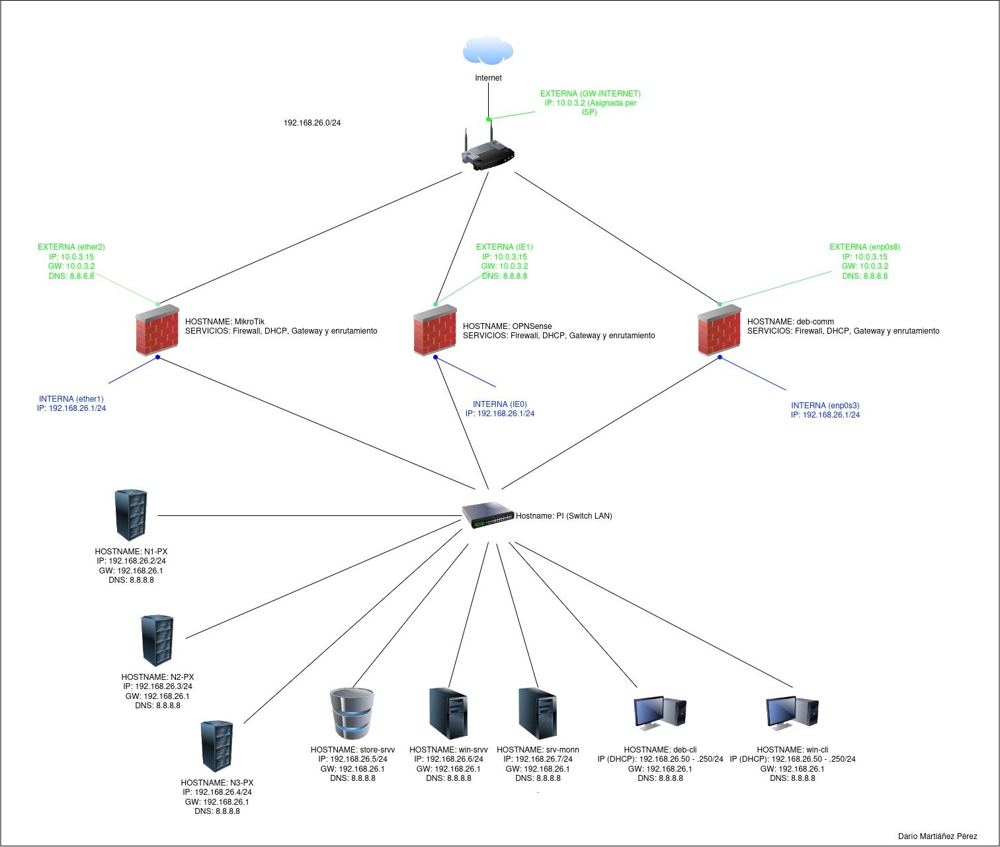

- **Resumen de rutas:** El tráfico interno de la LAN (`192.168.26.0/24`) se conmuta directamente a través del equipo de red virtual «PI», mientras que el tráfico hacia el exterior se enruta a través de la interfaz WAN activa del firewall correspondiente.

---

## 3. Tabla de Máquinas y Recursos Asignados

A continuación se detalla la planificación y dimensionamiento técnico de todos los elementos que componen la arquitectura virtualizada del sistema:

| Host / Entorno | Nombre VM | Función Principal | Sistema Operativo | vCPU | RAM | Almacenamiento | Red / Adaptadores | Direccionamiento IP / Rol |
| :--- | :--- | :--- | :--- | :---: | :---: | :--- | :--- | :--- |
| **Comm** | `MikroTik` | Firewall / Gateway | MikroTik RouterOS CHR v7.23.8 | 1 | 1024 MB | 128 MB (IDE) | **Adap 1:** Red Interna («PI») **Adap 2:** NAT | **LAN:** `192.168.26.1/24` **WAN:** `10.0.3.15` (DHCP) |
| **Comm** | `OPNSense` | Firewall / Gateway | FreeBSD (64-bit) | 1 | 3000 MB | 40,00 GB (IDE) | **Adap 1:** Red Interna («PI») **Adap 2:** NAT | **LAN:** `192.168.26.1/24` **WAN:** `10.0.3.15` (DHCP) |
| **Comm** | `deb-comm` | Firewall / Gateway | Debian 13 Trixie (64-bit) | 1 | 2048 MB | 20,00 GB (SATA) | **Adap 1:** Red Interna («PI») **Adap 2:** NAT | **LAN:** `192.168.26.1/24` **WAN:** `10.0.3.15` (DHCP) |
| **Proxmox** | `N1-PX` | Nodo 1 Clúster PVE | Debian / Proxmox VE | 2 | 4048 MB | 70,00 GB (SATA) | **Adap 1:** Red Interna («PI») | `192.168.26.2/24` (Nodo Clúster) |
| **Proxmox** | `N2-PX` | Nodo 2 Clúster PVE | Debian / Proxmox VE | 2 | 4048 MB | 70,00 GB (SATA) | **Adap 1:** Red Interna («PI») | `192.168.26.3/24` (Nodo Clúster) |
| **Proxmox** | `N3-PX` | Nodo 3 Clúster PVE | Debian / Proxmox VE | 2 | 4048 MB | 70,00 GB (SATA) | **Adap 1:** Red Interna («PI») | `192.168.26.4/24` (Nodo Clúster) |
| **Servers** | `win-srvv` | Control de Dominio / Identidades | Windows Server 2025 | 1 | 2048 MB | 50,00 GB (SATA) | **Adap 1:** Red Interna («PI») | `192.168.26.6/24` (Directorio Activo) |
| **Servers** | `store-srvv` | Almacenamiento / Copias | TrueNAS-SCALE-25.10.0 | 1 | 8048 MB | 20,00 GB (SATA) | **Adap 1:** Red Interna («PI») | `192.168.26.5/24` (NAS / Backup) |
| **Servers** | `srv-monn` | Monitorización sistemas | Lubuntu-26.04.1 | 2 | 2048 MB | 25,00 GB (SATA) | **Adap 1:** Red Interna («PI») | `192.168.26.7/24` (Grafana / Zabbix) |
| **Clients** | `win-cli` | Cliente Administrativo | Windows 11 (64-bit) | 2 | 4096 MB | **D0:** 80 GB / **D1:** 10 GB | **Adap 1:** Red Interna («PI») | `192.168.26.50-250` (DHCP) |
| **Clients** | `deb-cli` | Cliente Informática | Debian 13 Trixie (64-bit) | 1 | 2048 MB | 20,00 GB (SATA) | **Adap 1:** Red Interna («PI») | `192.168.26.50-250` (DHCP) |

---

## 4. Verificación de Conectividad y Enrutamiento (Apto+)

Para cumplir con los requisitos de ampliación y garantizar el correcto funcionamiento del entorno virtualizado, se han llevado a cabo las siguientes comprobaciones técnicas y recabado evidencias en vivo sobre las máquinas de la red:

---

### A. Pings (Verificación de Salida a la Red Exterior / Internet)

Comprobación de la salida efectiva hacia la red exterior y el router de enlace (`172.16.222.1` en el aula / `192.168.1.1` en casa) desde todas las máquinas virtuales de la red interna `192.168.26.0/24`, garantizando un 0% de pérdida de paquetes a través de la NAT del firewall activo:

* **Clúster Proxmox (`N1-PX`, `N2-PX`, `N3-PX`):**
  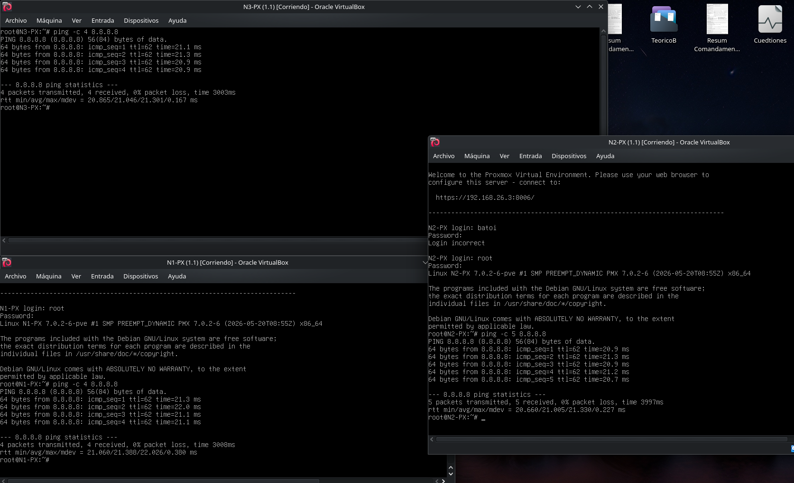

* **Servidores de Infraestructura y Almacenamiento (`win-srvv`, `store-srvv`, `srv-monn`):**
  

* **Clientes de Red (`win-cli` y `deb-cli`):**
  
  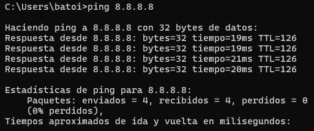

---

### B. Tabla de Enrutamiento (Servidores de Comunicaciones / Cortafuegos y Clientes)

Se muestran las tablas de encaminamiento activas en las tres alternativas de servidor de comunicaciones/firewall configuradas, así como en los clientes, verificando la ruta por defecto (`default via`) hacia la interfaz WAN y la ruta directa hacia la red interna «PI» (`192.168.26.0/24`):

* **1. MikroTik RouterOS (`ip route print`):**
  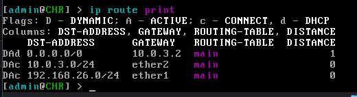

* **2. OPNsense (`netstat -rn` / Interfaz Web Routes):**
  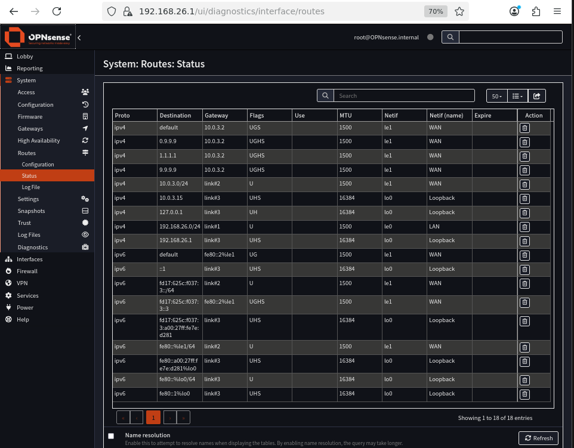

* **3. Debian 13 con nftables (`deb-comm` - `ip route`):**
  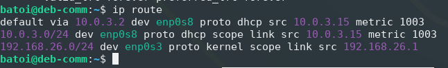

* **4. Comprobación de Tabla de Enrutamiento en Cliente (`deb-cli` - `ip route`):**
  En el cliente de pruebas (`deb-cli`), se confirma la obtención dinámica de IP vía DHCP (`192.168.26.109`) en el segmento `.50-.250` de la LAN, comprobando que la pasarela por defecto apunta directamente a `192.168.26.1`.
  

---

### C. Configuración de Interfaces de Red por Máquina Virtual

Detalle visual del direccionamiento IP, máscara de subred y estado de cada adaptador de red configurado en todas las máquinas del laboratorio:

#### 1. Servidores de Comunicaciones (WAN + LAN `192.168.26.1/24`)
* **MikroTik (`ip address print`):**
  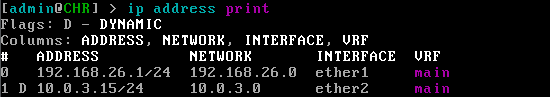
* **OPNsense (`ifconfig` / Consola):**
  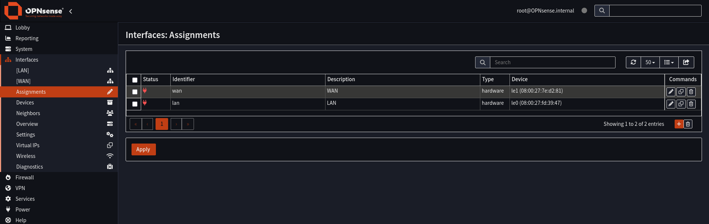
* **Debian Firewall (`deb-comm` - `ip a`):**
  Se verifica la correcta configuración dual de la red: la interfaz de la LAN (`enp0s3`) asignada estáticamente a `192.168.26.1/24` y la interfaz WAN (`enp0s8`) vinculada por DHCP a `10.0.3.15/24`.
  

#### 2. Clúster de Virtualización Proxmox VE
* **Nodo 1 (`N1-PX` - `192.168.26.2/24`):**
  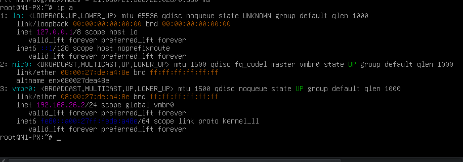
* **Nodo 2 (`N2-PX` - `192.168.26.3/24`):**
  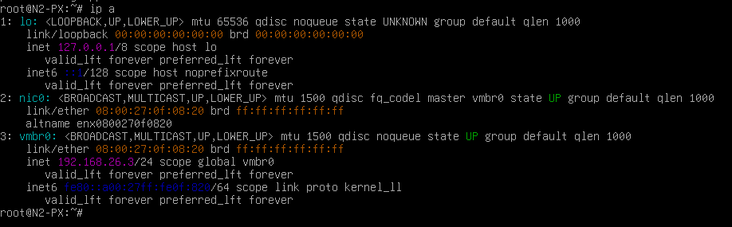
* **Nodo 3 (`N3-PX` - `192.168.26.4/24`):**
  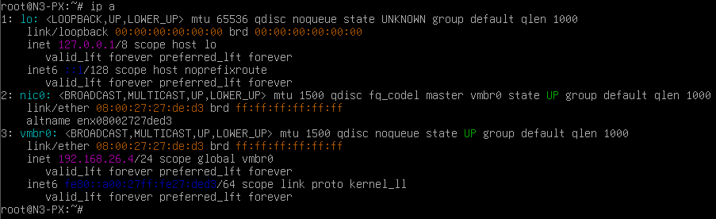

#### 3. Servidores Empresariales y Almacenamiento
* **TrueNAS SCALE (`store-srvv` - `192.168.26.5/24`):**
  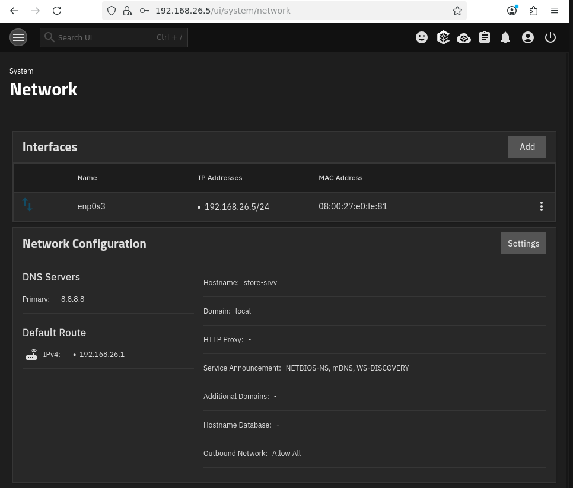
* **Windows Server 2025 (`win-srvv` - `192.168.26.6/24`):**
  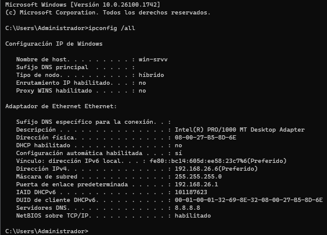
* **Servidor Monitorización (`srv-monn` - `192.168.26.7/24`):**
  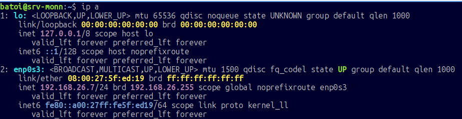

#### 4. Clientes de Red (Asignación DHCP `192.168.26.50-250`)
* **Cliente Windows 11 (`win-cli` - `ipconfig /all`):**
  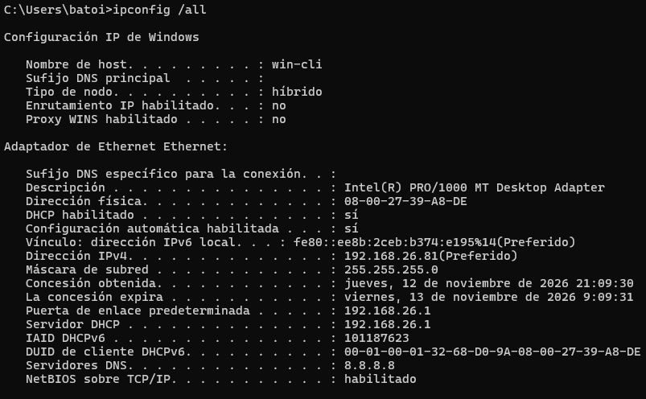
* **Cliente Debian 13 (`deb-cli` - `ip a`):**
  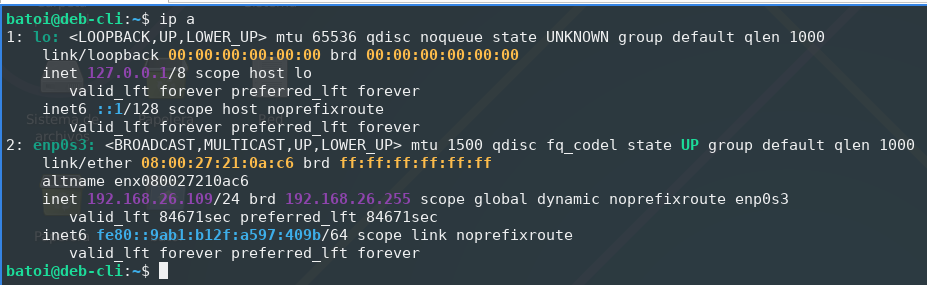
