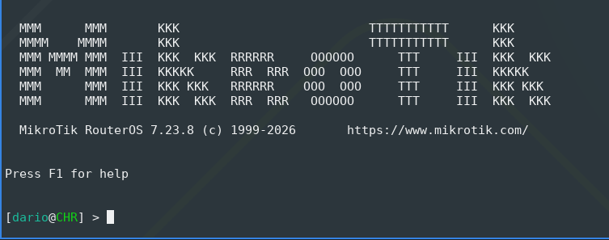
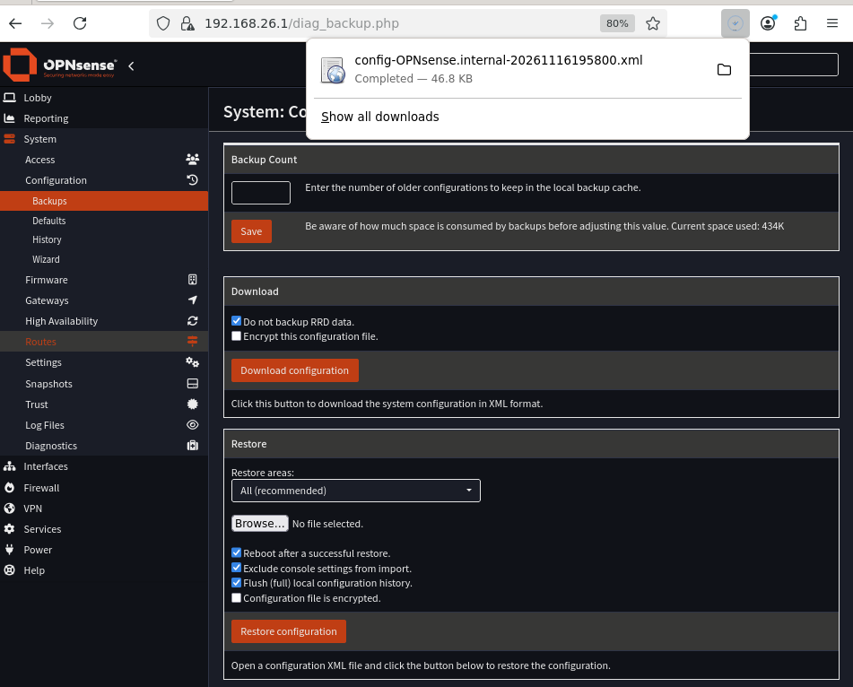
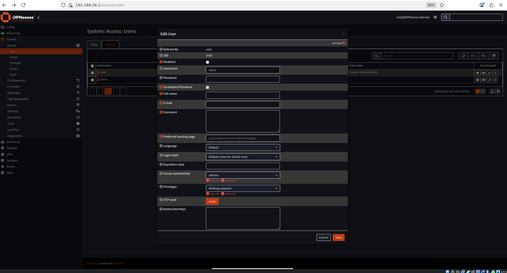
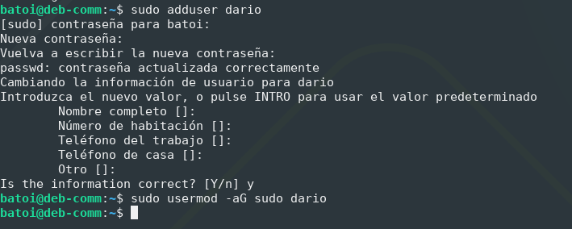
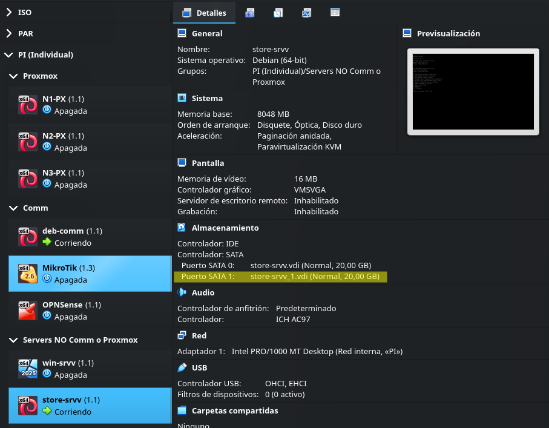
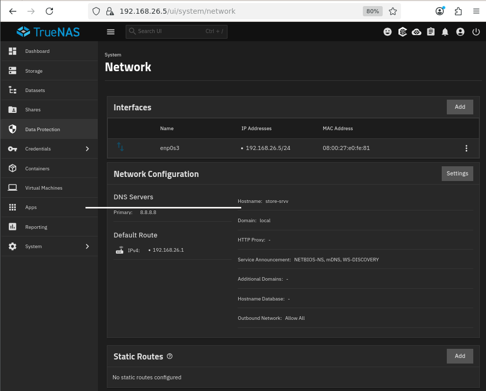
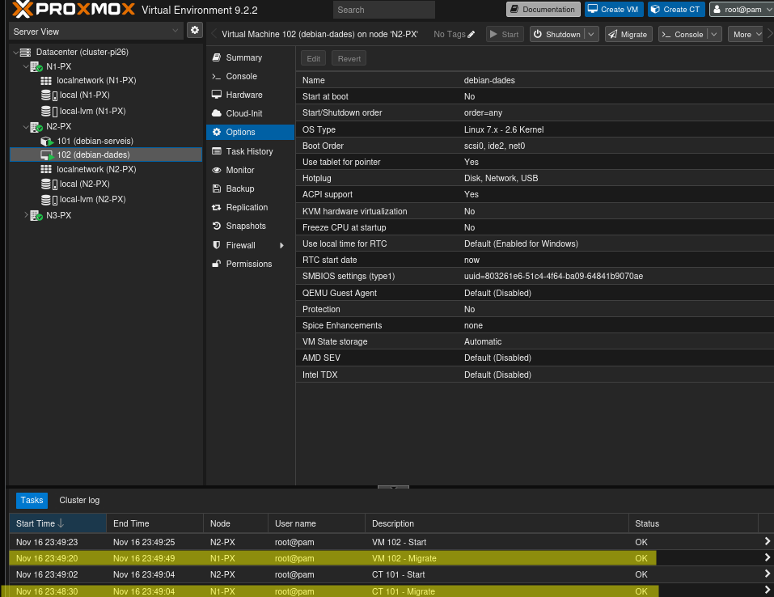

# Tarea 5: Instalación y Comunicaciones

## 1. Introducción y Objetivos
En esta tarea se realiza la instalación, configuración y comprobación de los sistemas operativos y servicios esenciales para nuestro entorno de pruebas individual, así como la conectividad de red, la virtualización y el sistema centralizado de copias de seguridad.

---

## 2. Desarrollo Obligatorio (Apto)

### 2.1. Servidores de Comunicaciones y Red
* **Sistemas implementados:** MikroTik, OPNsense y Debian con nftables (`debcomm`).
* **Configuración:** Asignación de usuarios de administración, configuración de interfaces WAN/LAN y reglas de filtrado para proporcionar acceso a Internet a la red interna.

**Evidencias:**
* Configuración de red en MikroTik:
  
  

* Copia de seguridad / baja MikroTik:
  
  

* Configuración en OPNsense:
  
  

* Configuración en Debian (`debcomm`):
  
  

---

### 2.2. Servidor de Almacenamiento y NAS (`storesrvv`)
* **Sistema:** TrueNAS.
* **Configuración:** Usuarios de administración, parámetros de red, configuración de discos adicionales y creación de datasets/pools para almacenar las copias de seguridad del entorno.

**Evidencias:**
* Disco adicional en VirtualBox:
  
  

* Red de store-srvv:
  
  

* Creación de pool y dataset:
  
  

* Verificación de las copias:
  
  

---

### 2.3. Clúster de Virtualización (`Proxmox VE - PX`)
* **Nodos:** N1-PX, N2-PX, N3-PX.
* **Tareas:** Configuración de red de los nodos, creación del clúster, despliegue de máquinas virtuales y pruebas de migración conectado a TrueNAS.

**Evidencias:**
* Estado del clúster:
  
  

* Servidores virtuales creados:
  
  

* Prueba de migración:
  
  

* Copias en TrueNAS:
  
  

---

### 2.4. Centralización de Dominio (`win-srvv` y `win-cli`)
* **Sistema:** Windows Server y Windows 11 (Client).
* **Tareas:** Creación del dominio, configuración de
