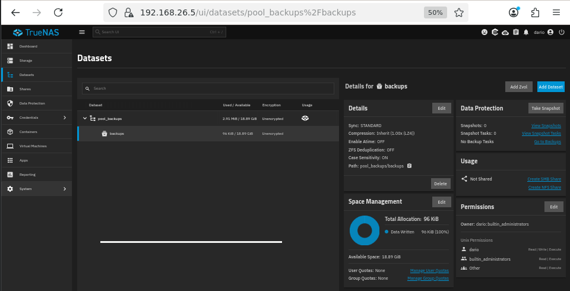
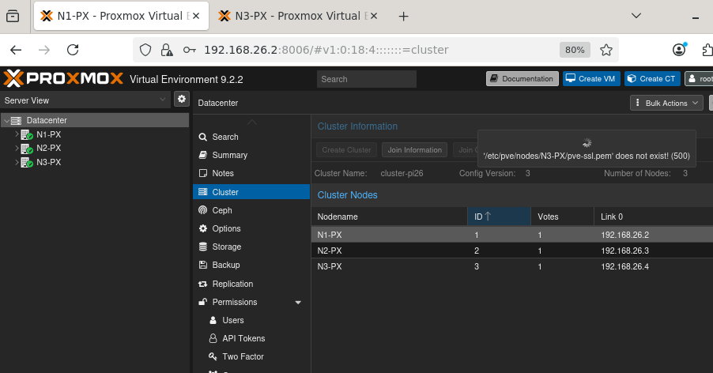
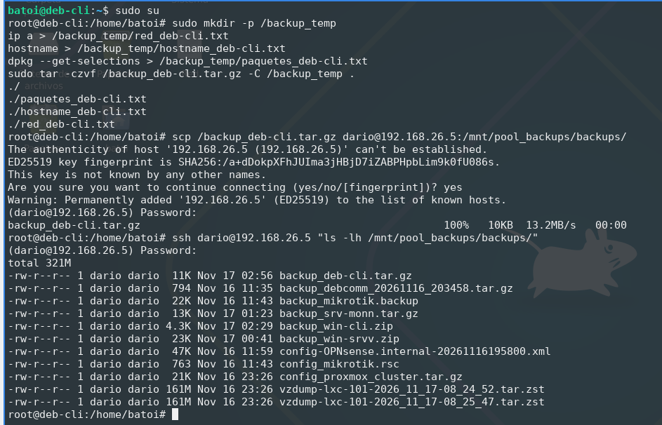

# Instalación y Comunicaciones - Tasca 5 (ASIX ThinkLab)

| Datos de Configuración | Detalle |
| :--- | :--- |
| **Alumno** | Darío Martiáñez Pérez |
| **Número de PC** | PC-26 |
| **Red Interna (LAN)** | `192.168.26.0/24` |
| **Módulos** | ISO / FDM |

---

## 1. Introducción y Objetivos de la Tasca 5

El presente documento recoge la implantación práctica, configuración y verificación de los sistemas operativos y servicios esenciales que componen el entorno de pruebas individualizado del departamento de informática, adaptado al puesto de trabajo **PC-26**.

Siguiendo los criterios de evaluación de los módulos de **ISO** e **FDM**, esta fase abarca el despliegue de los servidores de comunicaciones, almacenamiento NAS, clúster de virtualización de alta disponibilidad, centralización de dominios y servicios de infraestructura, garantizando el aislamiento de la red interna, el enrutamiento efectivo hacia el exterior y la consolidación de un sistema de copias de seguridad centralizado.

---

## 2. Servidores de Comunicaciones

Para cumplir con los requisitos de diseño y resiliencia del sistema, se han implementado y probado sucesivamente **tres alternativas de servidores de comunicaciones y cortafuegos** (`MikroTik`, `OPNSense` y `deb-comm`). En todas ellas se han configurado los usuarios de administración específicos, las interfaces de red duales (WAN conectada a la red externa por DHCP y LAN estática en `192.168.26.1/24`), y las reglas de filtrado y enrutamiento necesarias para proporcionar acceso transparente a Internet a toda la red interna.

### A. Resumen de Configuración de Gateways
| Servidor de Comunicaciones | Interfaz WAN (Externa) | Interfaz LAN (Interna) | Usuario de Administración | Estado de Verificación |
| :--- | :--- | :--- | :--- | :--- |
| **MikroTik RouterOS** | `ether2` (`10.0.3.15` - DHCP) | `ether1` (`192.168.26.1/24`) | `admin` / Seguretat per defecte | Verificat (Concurrencia única) |
| **OPNsense** | `wan` (`10.0.3.15` - DHCP) | `lan` (`192.168.26.1/24`) | `root` / `admin` | Verificat (Concurrencia única) |
| **Debian con nftables (`deb-comm`)** | `enp0s8` (`10.0.3.15` - DHCP) | `enp0s3` (`192.168.26.1/24`) | `dario` (Sudoers) | Verificat (Concurrencia única) |

### B. Evidencias de Ejecución y Configuración
- **Configuración de red y pasarela en MikroTik:**
  > 

- **Copia de seguridad y gestión en MikroTik:**
  > 

- **Configuración general de OPNsense:**
  > 

- **Configuración del servidor de comunicaciones Debian (`deb-comm`):**
  > 

---

## 3. Servidor de Almacenamiento y NAS (`store-srvv`)

Como pilar fundamental para la retención de datos y la política de resiliencia de la organización, se ha implementado el servidor de almacenamiento basado en **TrueNAS SCALE (`store-srvv`)**. 

Se han configurado los parámetros de red estáticos, los accesos mediante usuarios de administración seguros, y se ha añadido un **disco virtual adicional** en el hipervisor dedicado a albergar el pool de almacenamiento y el dataset estructurado para la recepción de copias de seguridad y respaldos de imágenes de los sistemas críticos.

### A. Parámetros Técnicos de Almacenamiento
- **Dirección IP LAN:** `192.168.26.5/24`
- **Sistema de Ficheros:** ZFS (Pool dedicado a respaldos)
- **Servicios Habilitados:** SMB / SSH / API de Gestión

### B. Evidencias del Servidor NAS
- **Configuración del disco virtual adicional en VirtualBox:**
  > 

- **Parámetros de red y conectividad IP:**
  > 

- **Creación de usuarios y pools de almacenamiento ZFS:**
  > 

- **Verificación de la integridad de los datasets de respaldo:**
  > 

---

## 4. Clúster de Virtualización (`Proxmox VE - PX`)

Se ha desplegado un clúster de virtualización de alta disponibilidad compuesto por **tres nodos** (`N1-PX`, `N2-PX`, `N3-PX`), interconectados en la red interna de la organización y vinculados al almacenamiento centralizado en TrueNAS. 

Se han llevado a cabo pruebas de creación de máquinas virtuales y contenedores, así como la migración en caliente entre nodos para comprobar el rendimiento y la eficiencia del clúster bajo los recursos dimensionados.

### A. Dimensión de Nodos del Clúster
| Nodo Proxmox | Dirección IP | vCPU | RAM Asignada | Almacenamiento | Rol en el Clúster |
| :--- | :--- | :---: | :---: | :---: | :--- |
| **`N1-PX`** | `192.168.26.2/24` | 2 | 4048 MB | 32,00 GB | Nodo 1 (Coordinador) |
| **`N2-PX`** | `192.168.26.3/24` | 2 | 4048 MB | 32,00 GB | Nodo 2 (Cómputo) |
| **`N3-PX`** | `192.168.26.4/24` | 2 | 4048 MB | 32,00 GB | Nodo 3 (Cómputo / Alta Disponibilidad) |

### B. Evidencias del Clúster Proxmox
- **Estado y validación del clúster de tres nodos:**
  > 

- **Despliegue de servidores virtuales en los nodos:**
  > 

- **Prueba de migración de cargas entre nodos:**
  > 

- **Integración de copias y snapshots con TrueNAS:**
  > 

---

## 5. Centralización de Dominio (`win-srvv` y `win-cli`)

Para estructurar la gestión administrativa centralizada de identidades, directivas y equipos dentro del departamento, se ha desplegado el servidor de directorio activo sobre **Windows Server 2025 (`win-srvv`)**, integrando de forma operativa el cliente administrativo **Windows 11 (`win-cli`)**.

### A. Configuración de Dominio
- **Dirección IP del Servidor:** `192.168.26.6/24`
- **Rol Principal:** Active Directory Domain Services (AD DS) y DNS
- **Integración de Clientes:** `win-cli` asociado correctamente al dominio corporativo con asignación DHCP estática/dinámica en el rango de la LAN.

### B. Evidencias de Centralización
- **Configuración de red y servicios en Windows Server:**
  > 

- **Unión e integración del cliente Windows 11 al dominio:**
  > 

---

## 6. Servidores de Infraestructura y Monitorización (`srv-monn` y `deb-cli`)

Se ha configurado el servidor de monitorización basado en entornos Linux (`srv-monn`) dotado de herramientas de supervisión activa de recursos, junto con el despliegue del entorno cliente de pruebas y validación operativo (`deb-cli`).

### A. Evidencias de Infraestructura
- **Panel de herramientas de supervisión en `srv-monn`:**
  > 

- **Verificación de red en el cliente Linux `deb-cli`:**
  > 

---

## 7. Sistema de Copias de Seguridad y Respaldo (Backups)

Con el propósito de mitigar fallos imprevistos y garantizar la recuperación ante desastres (*Disaster Recovery*), se han generado, verificado y volcado de forma sistemática los respaldos de configuración y snapshots de todos los elementos críticos del sistema hacia el servidor centralizado de almacenamiento (`store-srvv` / TrueNAS):

- **Respaldo del cliente Linux (`deb-cli`):**
  > 

- **Respaldo del firewall Debian (`deb-comm`):**
  > 

- **Respaldo del dispositivo de comunicaciones MikroTik:**
  > 

- **Respaldo del servidor de monitorización (`srv-monn`):**
  > 

- **Respaldo del cliente administrativo (`win-cli`):**
  > 

- **Respaldo del controlador de dominio (`win-srvv`):**
  > 

---

## 8. Ampliación (Apte+)

> **Estado Actual:** Apartado reservado para la implantación de mecanismos avanzados de automatización de respaldos (scripts de volcado personalizados combinados con la planificación de tareas mediante `cron` o servicios equivalentes) y la automatización de la recuperación de servicios críticos. 
> **Planificación:** Pendiente de concretar las directrices técnicas específicas con el profesorado para su posterior ejecución y documentación en el repositorio.
