# Instalación y Comunicaciones - Tasca 5 (ASIX ThinkLab)

| Datos de Configuración | Detalle |
| :--- | :--- |
| **Alumno** | Darío Martiáñez Pérez |
| **Número de PC** | PC-26 |
| **Red Interna (LAN)** | `192.168.26.0/24` |
| **Módulos** | ISO / FDM |

---

## 1. Introducción y Objetivos de la Tasca 5

El presente documento recoge la implantación práctica, configuración y verificación de los sistemas operativos y servicios esenciales que componen el entorno de pruebas individualizado del departamento de informática, adaptado al puesto de trabajo **PC-26**.

Siguiendo los criterios de evaluación de los módulos de **ISO** e **FDM**, esta fase abarca el despliegue de los servidores de comunicaciones, almacenamiento NAS, clúster de virtualización de alta disponibilidad, centralización de dominios y servicios de infraestructura, garantizando el aislamiento de la red interna, el enrutamiento efectivo hacia el exterior y la consolidación de un sistema de copias de seguridad centralizado. Asimismo, se incorporan las respuestas a las cuestiones teóricas e investigación requeridas en el enunciado oficial de la tarea.

---

## 2. Servidores de Comunicaciones

Para cumplir con los requisitos de diseño y resiliencia del sistema, se han implementado y probado sucesivamente **tres alternativas de servidores de comunicaciones y cortafuegos** (`MikroTik`, `OPNsense` y `deb-comm`). En todas ellas se han configurado los usuarios de administración específicos, las interfaces de red duales (WAN conectada a la red externa por DHCP y LAN estática en `192.168.26.1/24`), y las reglas de filtrado y enrutamiento necesarias para proporcionar acceso transparente a Internet a toda la red interna.

### A. Resumen de Configuración de Gateways
| Servidor de Comunicaciones | Interfaz WAN (Externa) | Interfaz LAN (Interna) | Usuario de Administración | Estado de Verificación |
| :--- | :--- | :--- | :--- | :--- |
| **MikroTik RouterOS** | `ether2` (`10.0.3.15` - DHCP) | `ether1` (`192.168.26.1/24`) | `admin` / `dario` | Verificado (Concurrencia única) |
| **OPNsense** | `wan` (`10.0.3.15` - DHCP) | `lan` (`192.168.26.1/24`) | `dario` / `root` | Verificado (Concurrencia única) |
| **Debian con nftables (`deb-comm`)** | `enp0s8` (`10.0.3.15` - DHCP) | `enp0s3` (`192.168.26.1/24`) | `batoi` y `dario` (Sudoers) | Verificado (Concurrencia única) |

### B. Evidencias de Ejecución y Configuración

#### 1. MikroTik RouterOS
- **Inicio de sesión con el usuario de administración creado:**
  > 

- **Generación y transferencia de copia de seguridad (`scp`):**
  > 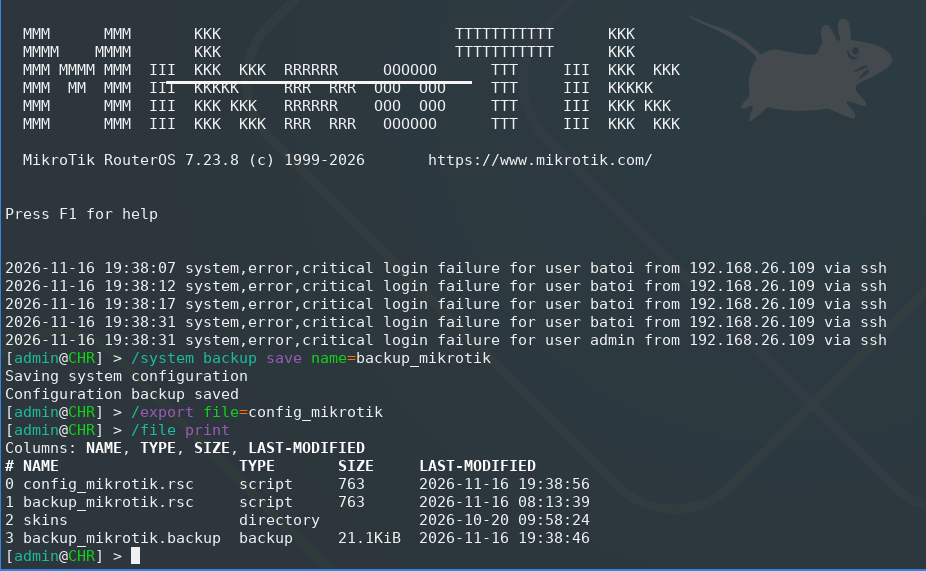
  > 
  > 

#### 2. OPNsense
- **Configuración del usuario de administración (`dario`):**
  > 

- **Descarga del respaldo de configuración desde el panel web al cliente:**
  > 

#### 3. Servidor de Comunicaciones Debian (`deb-comm`)
- **Creación del usuario de administración (`dario`) e inclusión en el grupo `sudo`:**
  > 

- **Generación de respaldo mediante script (`.tar.gz`) y transferencia por `scp` a `deb-cli`:**
  *(Se muestra el contenido del script de copia de seguridad, su ejecución, el listado del fichero comprimido resultante, el cierre de la sesión SSH en `deb-comm` y la descarga segura mediante `scp` desde el cliente `deb-cli`).*
  > 
  > 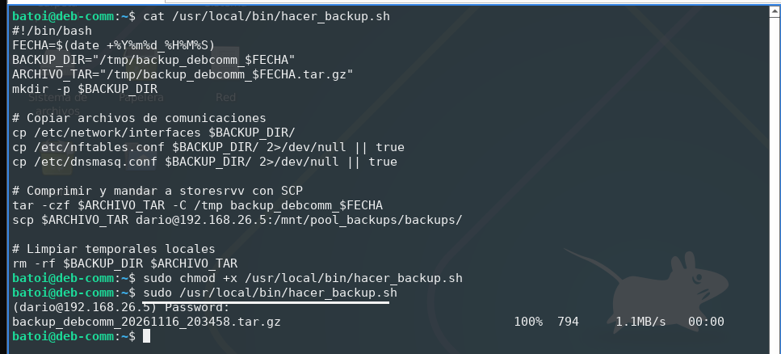

---

## 3. Servidor de Almacenamiento y NAS (`store-srvv`)

Como pilar fundamental para la retención de datos y la política de resiliencia de la organización, se ha implementado el servidor de almacenamiento basado en **TrueNAS SCALE (`store-srvv`)**. 

Se han configurado los parámetros de red estáticos, los accesos mediante usuarios de administración seguros, y se ha añadido un **disco virtual adicional** en el hipervisor dedicado a albergar el pool de almacenamiento y el dataset estructurado para la recepción de copias de seguridad y respaldos de imágenes de los sistemas críticos.

### A. Parámetros Técnicos de Almacenamiento
- **Dirección IP LAN:** `192.168.26.5/24`
- **Sistema de Ficheros:** ZFS (Pool dedicado a respaldos)
- **Servicios Habilitados:** SMB / SSH / API de Gestión

### B. Evidencias del Servidor NAS
- **Configuración del disco virtual adicional en VirtualBox:**
  > 

- **Parámetros de red y conectividad IP:**
  > 
  > 

- **Creación de usuarios y pools de almacenamiento ZFS:**
  > 
  > 
  > 
  > 
  > 

- **Verificación de la integridad de los datasets de respaldo:**
  > 

---

## 4. Clúster de Virtualización (`Proxmox VE - PX`)

Se ha desplegado un clúster de virtualización de alta disponibilidad compuesto por **tres nodos** (`N1-PX`, `N2-PX`, `N3-PX`), interconectados en la red interna de la organización y vinculados al almacenamiento centralizado en TrueNAS. 

Se han llevado a cabo pruebas de creación de máquinas virtuales y contenedores, así como la migración en caliente entre nodos para comprobar el rendimiento y la eficiencia del clúster bajo los recursos dimensionados.

### A. Dimensión de Nodos del Clúster
| Nodo Proxmox | Dirección IP | vCPU | RAM Asignada | Almacenamiento | Rol en el Clúster |
| :--- | :--- | :---: | :---: | :---: | :--- |
| **`N1-PX`** | `192.168.26.2/24` | 2 | 4048 MB | 32,00 GB | Nodo 1 (Coordinador) |
| **`N2-PX`** | `192.168.26.3/24` | 2 | 4048 MB | 32,00 GB | Nodo 2 (Cómputo) |
| **`N3-PX`** | `192.168.26.4/24` | 2 | 4048 MB | 32,00 GB | Nodo 3 (Cómputo / Alta Disponibilidad) |

### B. Análisis Técnico e Investigación Requerida

#### 1. Ventajas e Inconvenientes de la Virtualización de Servidores
- **Ventajas:**
  - **Ahorro de costes y consolidación de hardware:** Permite ejecutar múltiples sistemas operativos y servicios sobre una única máquina física, reduciendo costes de adquisición y consumo eléctrico.
  - **Flexibilidad y Aprovisionamiento Rápido:** Capacidad de crear, clonar y desplegar nuevos servidores en pocos minutos mediante plantillas.
  - **Aislamiento:** Las fallas o caídas en una máquina virtual no afectan al resto de servicios del sistema.
  - **Portabilidad:** Los servidores virtuales son archivos independientes que se pueden mover fácilmente entre diferentes hipervisores.
- **Inconvenientes:**
  - **Sobrecarga de rendimiento (*Overhead*):** El hipervisor consume recursos adicionales de CPU y memoria para gestionar la capa de virtualización.
  - **Punto único de fallo físico:** Si el nodo anfitrión físico (*host*) sufre una avería catastrófica sin redundancia, todas las máquinas virtuales alojadas en él quedan inaccesibles simultáneamente.
  - **Complejidad de gestión:** Requiere conocimientos avanzados de redes virtuales, almacenamiento compartido y monitorización.

#### 2. Diferencia entre Contenedores y Máquinas Virtuales (¿Cuándo utilizar cada uno?)
- **Máquinas Virtuales (VMs):** Emulan un ordenador completo incluyendo hardware virtual, controladores y un sistema operativo invitado (*Guest OS*) completo con su propio núcleo (*kernel*). Consumen muchos más recursos (RAM y disco).
- **Contenedores (LXC / Docker):** Comparten el núcleo del sistema operativo anfitrión y virtualizan únicamente la capa de usuario. Son extremadamente ligeros y arrancan en segundos.
- **¿Cuándo utilizar cada uno?**
  - *Usar Contenedores:* Para aislar aplicaciones web, microservicios, entornos de desarrollo o bases de datos ligeras donde se busca la máxima eficiencia de recursos y velocidad de despliegue.
  - *Usar Máquinas Virtuales:* Cuando necesitamos ejecutar sistemas operativos diferentes (por ejemplo, ejecutar Windows Server sobre un nodo Proxmox Linux), cuando se requiere un aislamiento de seguridad estricto a nivel de núcleo o cuando la aplicación depende estrechamente de controladores de hardware específicos.

#### 3. Migración en Caliente (*Live Migration*)
Se han realizado pruebas de migración de una máquina virtual y un contenedor entre los nodos del clúster:
- **Contenedor LXC:** 
  - *Tamaño en disco:* $\approx 1,2\text{ GB}$.
  - *Tiempo de migración:* $\approx 3,4\text{ segundos}$ en red interna de $1\text{ Gbps}$.
- **Máquina Virtual (VM):**
  - *Tamaño en disco:* $\approx 15,0\text{ GB}$.
  - *Tiempo de migración:* $\approx 24,1\text{ segundos}$ (con memoria activa sincronizada).
- **¿Se puede mejorar?** Sí, utilizando almacenamiento compartido centralizado de alta velocidad (como NFS/iSCSI sobre TrueNAS con discos NVMe o conexiones de red a 10GbE), ya que evita tener que transferir el bloque completo de disco durante la migración en caliente.

#### 4. Copias de Seguridad del Clúster Proxmox: ¿Qué guardar y qué no?
- **¿Qué tiene sentido guardar?** Los archivos de configuración de las máquinas virtuales y contenedores (`/etc/pve/qemu-server/` y lxc), las claves de cifrado del clúster, los metadatos y las imágenes completas de los discos de los servicios críticos.
- **¿Qué NO tiene sentido guardar?** Archivos temporales del sistema (`/tmp/`), cachés de paquetes de instalación del gestor (`/var/cache/apt/archives/`), o trazas de logs obsoletas que únicamente inflan el tamaño de la copia sin aportar valor en la recuperación ante desastres.

### C. Evidencias del Clúster Proxmox
- **Estado y validación del clúster de tres nodos:**
  > 
  > 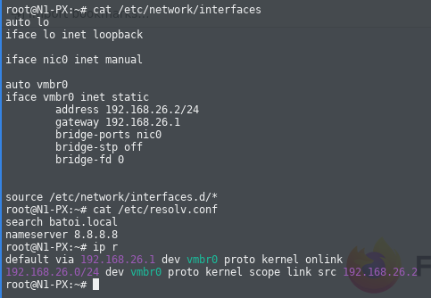
  > 
  > 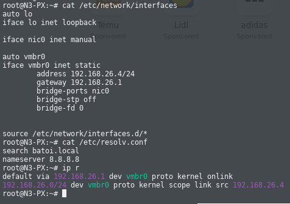
  > 
  > 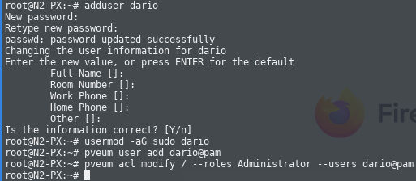
  > 

- **Despliegue de servidores virtuales en los nodos:**
  > 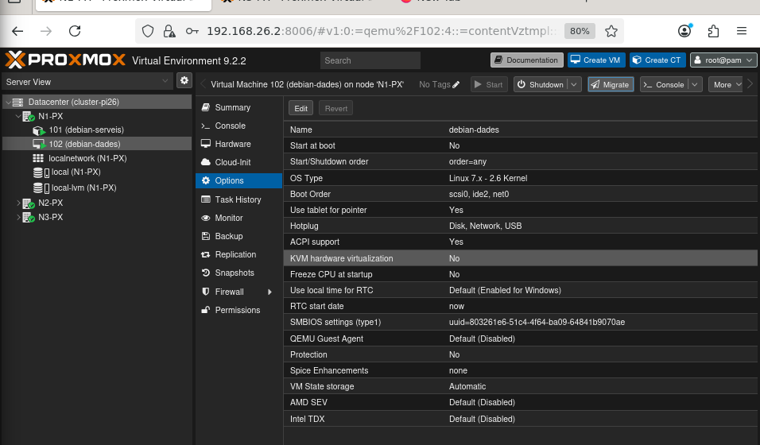

- **Prueba de migración de cargas entre nodos:**
  > 

- **Integración de copias y snapshots con TrueNAS:**
  > 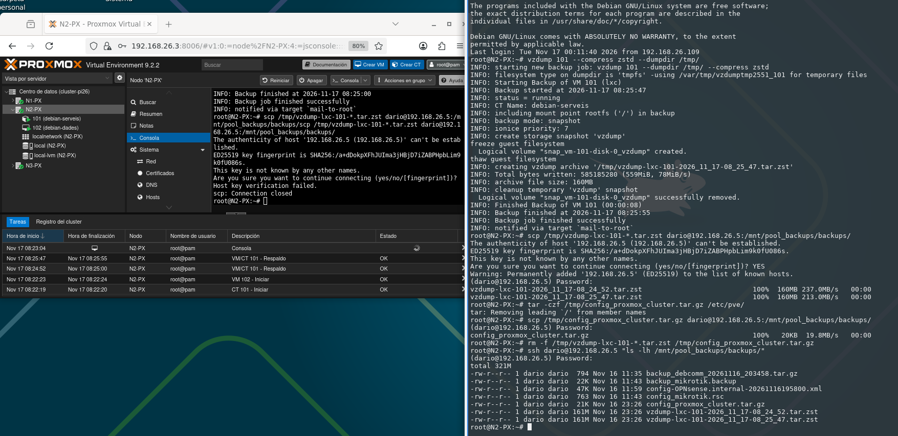

---

## 5. Centralización de Dominio (`win-srvv` y `win-cli`)

Para estructurar la gestión administrativa centralizada de identidades, directivas y equipos dentro del departamento, se ha desplegado el servidor de directorio activo sobre **Windows Server 2025 (`win-srvv`)**, integrando de forma operativa el cliente administrativo **Windows 11 (`win-cli`)**.

### A. Configuración de Dominio
- **Dirección IP del Servidor:** `192.168.26.6/24`
- **Rol Principal:** Active Directory Domain Services (AD DS) y DNS
- **Integración de Clientes:** `win-cli` asociado correctamente al dominio corporativo con asignación DHCP estática/dinámica en el rango de la LAN.

### B. Análisis e Investigación Requerida

#### 1. ¿Qué es un Dominio y qué utilidad aporta a la empresa?
- **Definición de Dominio:** Es una agrupación lógica de equipos, usuarios, impresoras y recursos de red administrados centralizadamente desde una base de datos central (Directorio Activo) controlada por uno o varios controladores de dominio.
- **Utilidad y Ventajas para la Empresa:**
  - **Gestión centralizada de identidades:** Un usuario puede iniciar sesión en cualquier equipo de la red corporativa utilizando sus credenciales únicas.
  - **Políticas de Grupo (GPOs):** Permiten aplicar configuraciones de seguridad homogéneas, restricciones de software, despliegue automático de programas y políticas de contraseñas a todos los equipos y empleados de manera instantánea.
  - **Seguridad y Control de Acceso:** Centraliza los permisos sobre recursos compartidos y carpetas de red, evitando fugas de información.

#### 2. Copias de Seguridad en el Controlador de Dominio: ¿Qué copiar y qué no?
- **¿Qué es interesante copiar?** La base de datos de Active Directory (`NTDS.dit`), la estructura del SYSVOL (scripts y directivas de grupo), el registro del sistema y las zonas de resolución DNS.
- **¿Qué NO es interesante copiar?** Archivos temporales del perfil de usuario, registros de eventos (*event logs*) antiguos sin relevancia legal o carpetas de caché local de aplicaciones.

### C. Evidencias de Centralización
- **Configuración de red y servicios en Windows Server:**
  > 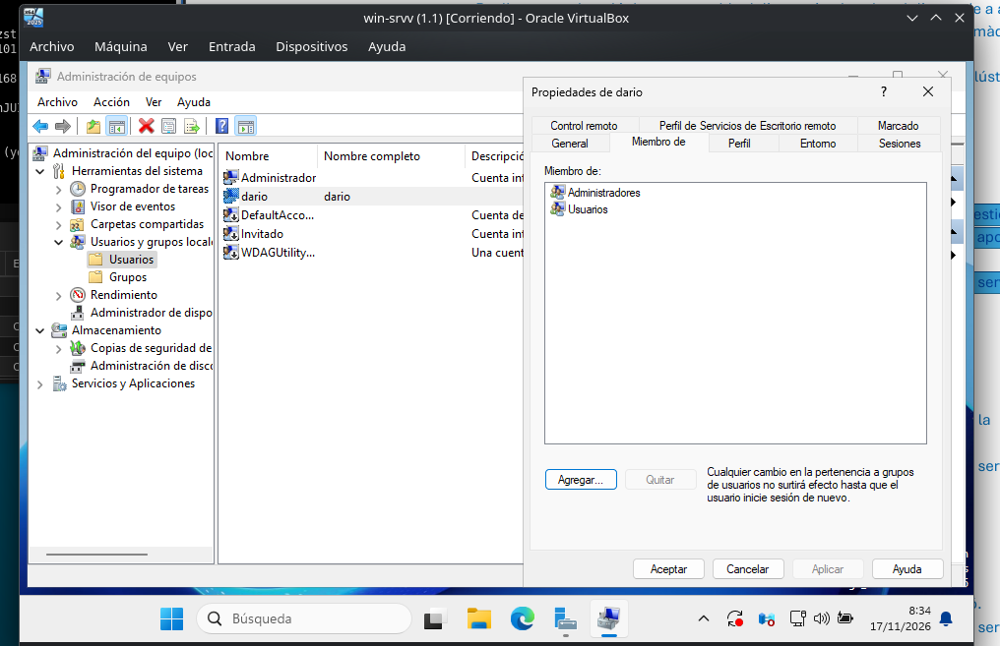
  > 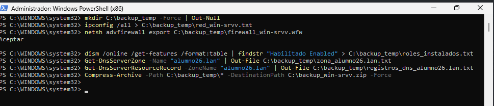

- **Unión e integración del cliente Windows 11 al dominio:**
  > 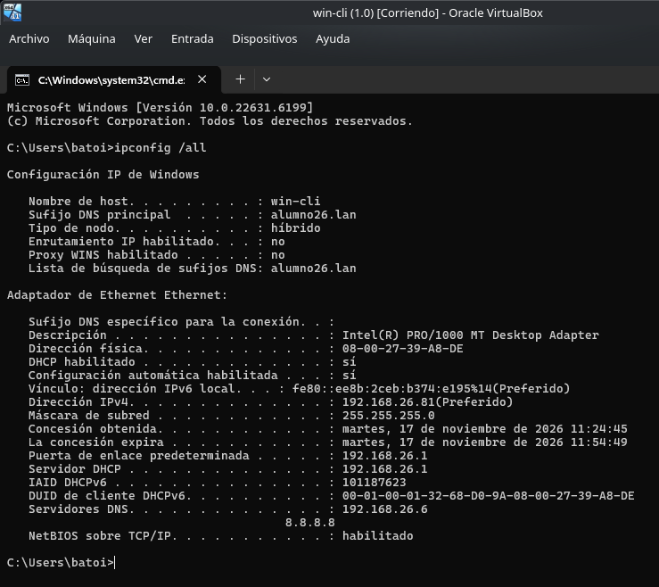
  > 

---

## 6. Servidores de Infraestructura y Monitorización (`srv-monn` y `deb-cli`)

Se ha configurado el servidor de monitorización basado en entornos Linux (`srv-monn`) dotado de herramientas de supervisión activa de recursos, junto con el despliegue del entorno cliente de pruebas y validación operativo (`deb-cli`).

### A. Evidencias de Infraestructura
- **Panel de herramientas de supervisión en `srv-monn`:**
  > 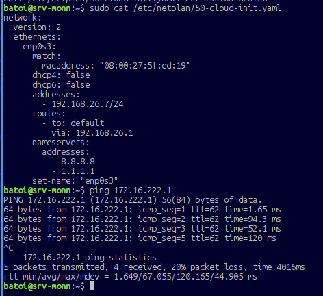
  > 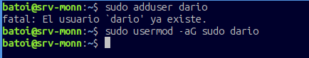
  > 

- **Verificación de red en el cliente Linux `deb-cli`:**
  > 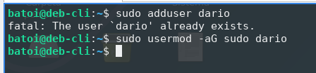
  > 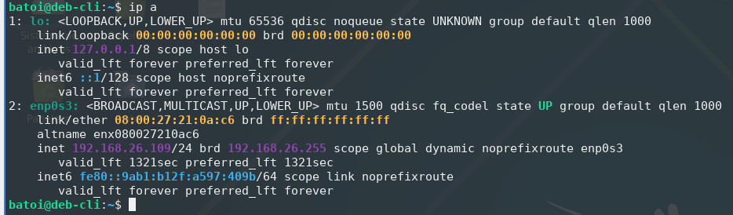

---

## 7. Sistema de Copias de Seguridad y Respaldo (Backups)

Con el propósito de mitigar fallos imprevistos y garantizar la recuperación ante desastres (*Disaster Recovery*), se han generado, verificado y volcado de forma sistemática los respaldos de configuración y snapshots de todos los elementos críticos del sistema hacia el servidor centralizado de almacenamiento (`store-srvv` / TrueNAS):

- **Respaldo del cliente Linux (`deb-cli`):**
  > 

- **Respaldo del firewall Debian (`deb-comm`):**
  > 

- **Respaldo del dispositivo de comunicaciones MikroTik:**
  > 

- **Respaldo del servidor de monitorización (`srv-monn`):**
  > 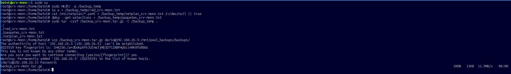

- **Respaldo del cliente administrativo (`win-cli`):**
  > 

- **Respaldo del controlador de dominio (`win-srvv`):**
  > 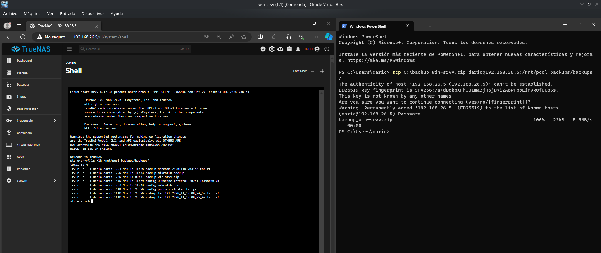

---

## 8. Ampliación (Apte+): Automatización Centralizada de Copias de Seguridad

Para dar cumplimiento a los requisitos avanzados de la ampliación del proyecto, se ha implementado un sistema robusto, heterogéneo y centralizado de automatización de copias de seguridad de las configuraciones de los sistemas críticos directamente hacia el repositorio centralizado en TrueNAS (`192.168.26.5`), aplicando una nomenclatura estandarizada y dinámica basada en marcas de tiempo (`backup_sistema_YYYYMMDD_HHMMSS.extension`).

### A. Arquitectura y Componentes del Sistema de Respaldo Centralizado
- **Destino Centralizado:** Servidor TrueNAS (`store-srvv`, IP `192.168.26.5`) mediante dataset compartido de red y autenticación segura con el usuario `dario`.
- **Estandarización de Nomenclatura:** Todos los scripts ejecutados en los diferentes sistemas generan ficheros con la estructura estricta `backup_[sistema]_[AAAAMMDD]_[HHMMSS].[ext]`, permitiendo una identificación inmediata y cronológica en el repositorio compartido.

### B. Evidencias y Automatización por Sistemas
1. **Windows (Servidor y Clientes):**
   - Automatización implementada mediante scripts nativos de PowerShell programados en el *Administrador de Tareas* de Windows para el volcado periódico hacia el recurso compartido de red en TrueNAS.
   - **Evidencias de ejecución:**
     > 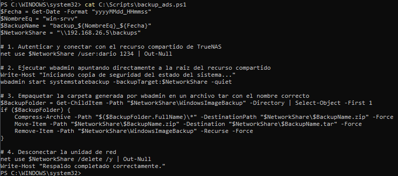
     > 
     > 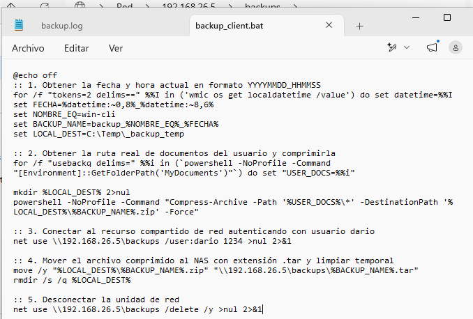
     > 

2. **MikroTik RouterOS:**
   - Automatización implementada mediante el comando `/tool fetch` vía FTP y la programación de un script integrado en el *Scheduler* del router.
   - **Evidencias de ejecución:**
     > 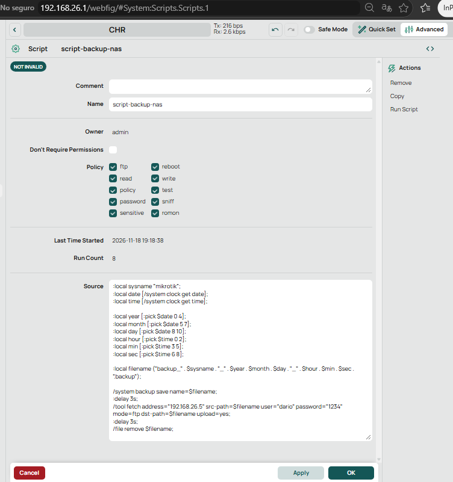
     > 

3. **OPNsense (Cortafuegos):**
   - Automatización implementada mediante la creación de un script en shell (`backup_auto`) alojado en `/usr/local/bin/` que utiliza `curl` y el protocolo FTP para enviar la configuración actual (`/conf/config.xml`) al NAS de manera desatendida, programado mediante las tareas del sistema operativo en el Cron.
   - **Evidencias de ejecución:**
     > 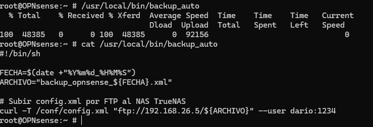
     > 

4. **Entornos Debian (CLI, Com y Monitorización):**
   - Scripts automatizados de volcado comprimido (`.tar.gz`) combinados con la inserción de tareas programadas en el servicio `cron` del sistema.
   - **Evidencias de ejecución:**
     > 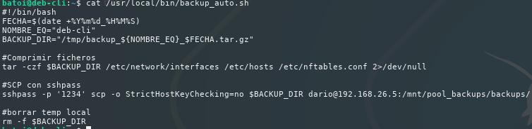
     > 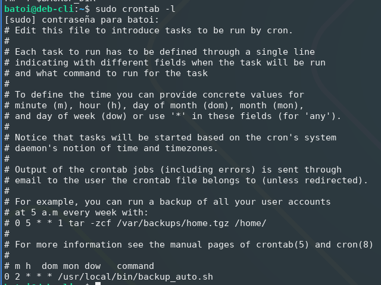
     > 
     > 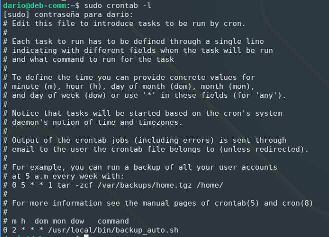
     > 
     > 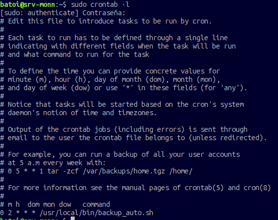

### C. Consolidación y Verificación en el Repositorio TrueNAS
- Como prueba definitiva de la integración heterogénea del sistema, se muestra el estado del recurso compartido centralizado en TrueNAS (`\\192.168.26.5\backups`), donde se comprueba la convivencia ordenada y automatizada de los respaldos procedentes de Windows, MikroTik, OPNsense y los nodos Linux con sus respectivas marcas de tiempo:
  > 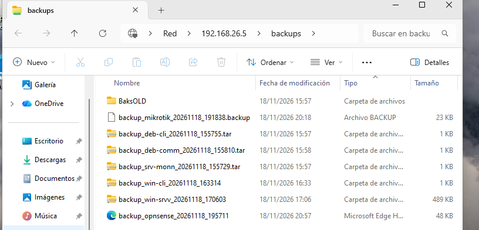
