# Instalación y Comunicaciones - Tasca 5 (ASIX ThinkLab)

| Datos de Configuración | Detalle |
| :--- | :--- |
| **Alumno** | Darío Martiáñez Pérez |
| **Número de PC** | PC-26 |
| **Red Interna (LAN)** | `192.168.26.0/24` |
| **Módulos** | ISO / FDM |

---

## 1. Introducción y Objetivos de la Tasca 5

El presente documento recoge la implantación práctica, configuración y verificación de los sistemas operativos y servicios esenciales que componen el entorno de pruebas individualizado del departamento de informática, adaptado al puesto de trabajo **PC-26**.

Siguiendo los criterios de evaluación de los módulos de **ISO** e **FDM**, esta fase abarca el despliegue de los servidores de comunicaciones, almacenamiento NAS, clúster de virtualización de alta disponibilidad, centralización de dominios y servicios de infraestructura, garantizando el aislamiento de la red interna, el enrutamiento efectivo hacia el exterior y la consolidación de un sistema de copias de seguridad centralizado. Asimismo, se incorporan las respuestas a las cuestiones teóricas, análisis de riesgos, tiempos de respuesta ante incidencias y pruebas prácticas de recuperación ante fallos controlados requeridos en la rúbrica oficial.

---

## 2. Comprobación de Origen e Integridad de las ISOs

Para garantizar que los medios de instalación empleados en el despliegue del entorno no han sido alterados y coinciden de manera íntegra con las fuentes oficiales de los fabricantes, se ha llevado a cabo una validación automatizada mediante huellas criptográficas `sha256sum`. 

Se han contrastado las sumas locales almacenadas en el fichero `hash.txt` frente a las referencias oficiales registradas en `hash_oficial.txt`, utilizando la utilidad de comparación `diff` para certificar la coincidencia exacta de los ficheros operativos.

### A. Metodología de Validación e Interpretación de Resultados
La integridad criptográfica asegura que las imágenes del sistema operativo descargadas no contienen modificaciones maliciosas (*tampering*) ni errores de transmisión durante la descarga. El proceso automatizado verifica cada archivo ISO comparando su hash SHA-256 local con el proporcionado por el desarrollador:
1. **Generación de sumas locales:** `sha256sum *.iso > hash.txt`
2. **Contrastado estricto:** `diff -u hash_oficial.txt hash.txt`
3. **Interpretación técnica:** El comando `diff` devuelve una salida completamente vacía (código de salida `0`), lo que certifica matemáticamente que no existe ni un solo bit de discrepancia entre los medios locales y los oficiales.

### B. Evidencia de Validación de Hashes
- **Comprobación mediante `diff` y volcado de los ficheros locales y oficiales:**
  > 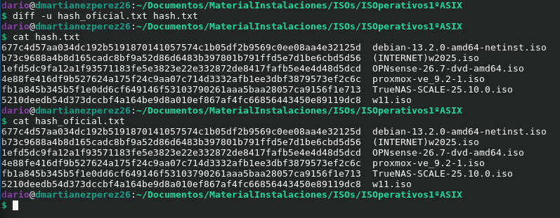

---

## 3. Servidores de Comunicaciones (Gestión de Incidencias y Trazabilidad)

Para cumplir con los requisitos de diseño y resiliencia del sistema, se han implementado y probado sucesivamente **tres alternativas de servidores de comunicaciones y cortafuegos** (`MikroTik`, `OPNsense` y `deb-comm`). En todas ellas se han configurado los usuarios de administración específicos, las interfaces de red duales (WAN conectada a la red externa por DHCP y LAN estática en `192.168.26.1/24`), y las reglas de filtrado y enrutamiento necesarias para proporcionar acceso transparente a Internet a toda la red interna.

### A. Matriz de Riesgos, Configuraciones Críticas y Tiempos de Respuesta (RTO)
Con el objetivo de identificar posibles problemas en los sistemas, detectar configuraciones críticas y cuantificar los tiempos de respuesta ante una incidencia de instalación, arranque o caída de servicio, se ha elaborado la siguiente tabla de continuidad operativa basada en el repositorio centralizado de TrueNAS (`192.168.26.5`):

| Sistema / Servicio | Configuración Crítica | Posible Incidencia / Punto Único de Fallo (SPOF) | Procedimiento de Respuesta y Recuperación | Tiempo de Respuesta Estimado (RTO) |
| :--- | :--- | :--- | :--- | :--- |
| **Gateways (`MikroTik`, `OPNsense`, `deb-comm`)** | Tablas NAT, rutas por defecto y reglas de filtrado (`nftables.conf` / `config.xml`). | Corrupción de reglas de firewall, bloqueo accidental de interfaz LAN o fallo de arranque tras actualización. | Restauración del fichero de configuración (`.backup`, `.xml` o `.tar.gz`) desde el NAS o conmutación inmediata a gateway alternativo. | **$< 2\text{ minutos}$** |
| **Almacenamiento NAS (`store-srvv`)** | Pool ZFS (`pool_backups`), permisos de datasets y servicio SSH/SMB. | Desmontaje del volumen de red o saturación de espacio que impida la recepción de copias. | Importación del pool ZFS (`zpool import`) y verificación de conectividad de red estática (`192.168.26.5`). | **$< 3\text{ minutos}$** |
| **Clúster Proxmox (`N1-PX` a `N3-PX`)** | Ficheros de definición `/etc/pve/qemu-server/`, quórum Corosync y red del clúster. | Caída física o de arranque de uno de los nodos anfitriones del clúster. | Migración en caliente (*Live Migration*) o arranque de emergencia en nodo secundario desde snapshot en NAS. | **$< 30\text{ segundos}$** (en caliente) |
| **Controlador de Dominio (`win-srvv`)** | Base de datos Active Directory (`NTDS.dit`), carpeta `SYSVOL` y zonas DNS. | Corrupción de la base de datos de identidades o fallo de resolución DNS en la red interna. | Arranque en Modo de Restauración de Servicios de Directorio (DSRM) y volcado desde copia de seguridad del NAS. | **$\approx 10\text{ minutos}$** |
| **Clientes y Servicios (`deb-cli`, `debian-serveis`, `debian-dades`)** | Ficheros `/etc/network/interfaces`, demonios activos y perfiles en `/home`. | Fallo de disco del cliente o borrado accidental de ficheros de configuración de servicios. | Reinstalación limpia desde ISO verificada y volcado directo de `/etc` y `/home` vía `scp` desde TrueNAS. | **$\approx 8\text{ minutos}$** |

### B. Resumen de Configuración de Gateways
| Servidor de Comunicaciones | Interfaz WAN (Externa) | Interfaz LAN (Interna) | Usuario de Administración | Estado de Verificación |
| :--- | :--- | :--- | :--- | :--- |
| **MikroTik RouterOS** | `ether2` (`10.0.3.15` - DHCP) | `ether1` (`192.168.26.1/24`) | `admin` / `dario` | Verificado (Concurrencia única) |
| **OPNsense** | `wan` (`10.0.3.15` - DHCP) | `lan` (`192.168.26.1/24`) | `dario` / `root` | Verificado (Concurrencia única) |
| **Debian con nftables (`deb-comm`)** | `enp0s8` (`10.0.3.15` - DHCP) | `enp0s3` (`192.168.26.1/24`) | `batoi` y `dario` (Sudoers) | Verificado (Concurrencia única) |

### C. Evidencias de Ejecución y Análisis de Trazas de Seguridad

#### 1. MikroTik RouterOS
- **Inicio de sesión con el usuario de administración creado:**
  > 

- **Generación y transferencia de copia de seguridad (`scp`):**
  > 
  > 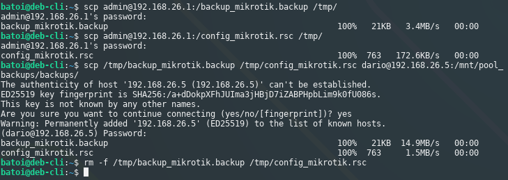
  > 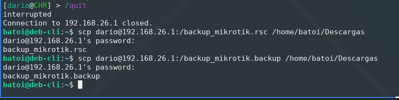

- **Filtrado de tráfico (Bloqueo a `1.1.1.1`) y verificación de registros (`/log print`):**
  > 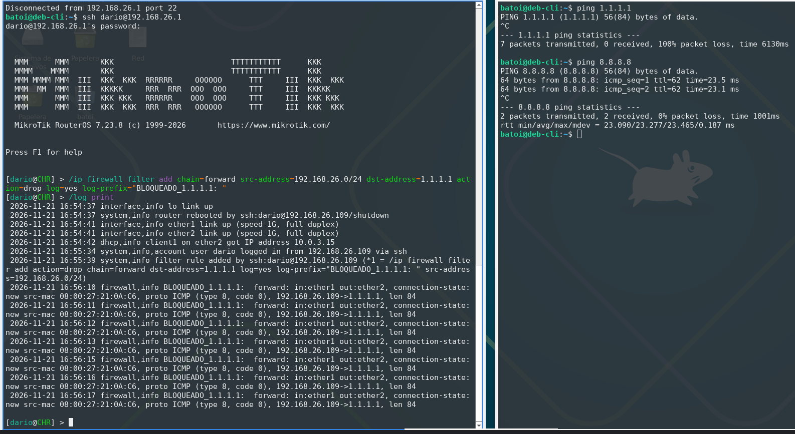
  - **Interpretación técnica de la traza:** En la captura del registro se observa la etiqueta `BLOQUEADO_1.1.1.1: forward: in:ether1 out:ether2`, identificando que el paquete entra por la interfaz interna (`ether1`), intenta enrutarse hacia la salida (`ether2`) con protocolo `ICMP (type 8, code 0)` desde el cliente interno hacia `1.1.1.1`, siendo descartado al instante mientras el tráfico hacia `8.8.8.8` fluye con normalidad.

#### 2. OPNsense
- **Configuración del usuario de administración (`dario`):**
  > 

- **Descarga del respaldo de configuración desde el panel web al cliente:**
  > 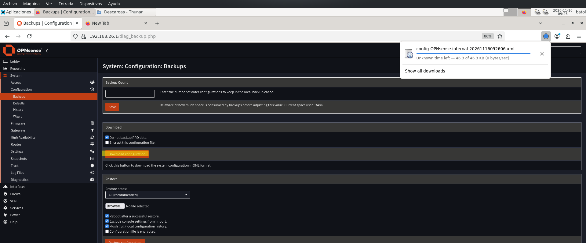

- **Filtrado de tráfico (Bloqueo a `1.1.1.1`) y supervisión en tiempo real (*Live View*):**
  > 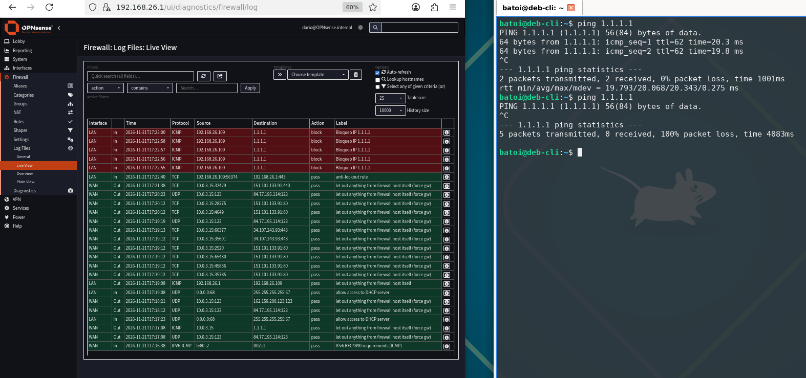
  - **Interpretación técnica de la traza:** El panel *Live View* muestra en tiempo real la entrada marcada en rojo en la interfaz `LAN` (`Action: block`), detallando la dirección IP de origen del cliente (`deb-cli`), el destino `1.1.1.1`, el protocolo `icmp` y el nombre de la regla desencadenante (`Bloqueo IP 1.1.1.1`), confirmando el corte efectivo al 100% de pérdida de paquetes en el terminal cliente.

#### 3. Servidor de Comunicaciones Debian (`deb-comm`)
- **Creación del usuario de administración (`dario`) e inclusión en el grupo `sudo`:**
  > 

- **Generación de respaldo mediante script (`.tar.gz`) y transferencia por `scp` a `deb-cli`:**
  *(Se muestra el contenido del script de copia de seguridad, su ejecución, el listado del fichero comprimido resultante, el cierre de la sesión SSH en `deb-comm` y la descarga segura mediante `scp` desde el cliente `deb-cli`).*
  > 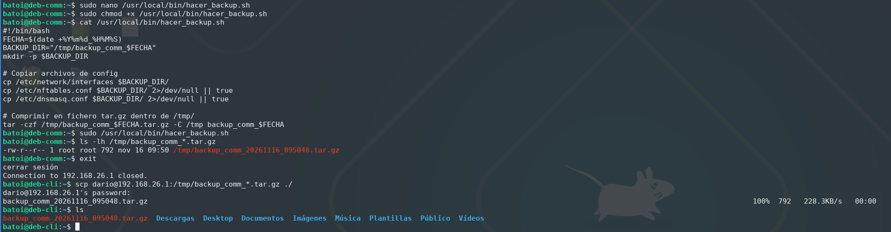

- **Filtrado con `nftables` (Bloqueo a `1.1.1.1`) y trazas del núcleo (`dmesg`):**
  > 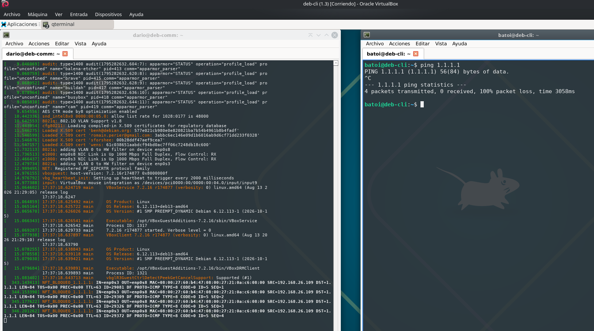
  - **Interpretación técnica de la traza:** La salida del kernel (`dmesg`) registra el prefijo personalizado `NFT_BLOQUEO_1.1.1.1:` junto con los parámetros de red `IN=enp0s3 OUT=enp0s8 SRC=192.168.26.x DST=1.1.1.1 PROTO=ICMP TYPE=8 CODE=0`. Esto demuestra que el motor `netfilter` intercepta y registra el paquete en la cadena `forward` antes de permitir su salida por la interfaz WAN.

---

## 4. Servidor de Almacenamiento y NAS (`store-srvv`) - Política de Respaldo

Como pilar fundamental para la retención de datos y la política de resiliencia de la organización, se ha implementado el servidor de almacenamiento basado en **TrueNAS SCALE (`store-srvv`)**. 

Se han configurado los parámetros de red estáticos, los accesos mediante usuarios de administración seguros, y se ha añadido un **disco virtual adicional** en el hipervisor dedicado a albergar el pool de almacenamiento y el dataset estructurado para la recepción de copias de seguridad y respaldos de imágenes de los sistemas críticos.

### A. Justificación Técnica: Qué, Cómo y Dónde se Almacena
* **¿Qué se copia?** Archivos de configuración de red, scripts de automatización, bases de datos de servicios (`/etc`, `/home`, configuraciones de cortafuegos) y snapshots de máquinas virtuales. Se excluyen deliberadamente directorios temporales (`/tmp`), cachés de paquetes (`/var/cache/apt`), sistemas de ficheros virtuales (`/proc`, `/sys`) y registros rotados antiguos para optimizar el espacio de almacenamiento, reducir la ventana de transferencia por red y evitar inconsistencias.
* **¿Cómo se realiza?** Mediante empaquetado y compresión estructurada en archivos `.tar.gz` (en entornos Linux/BSD) y archivos nativos de exportación (`.backup` en MikroTik, `.xml` en OPNsense), identificados con marcas temporales (`YYYYMMDD_HHMMSS`) y transferidos mediante canales cifrados (`scp` sobre SSH) o recursos compartidos autenticados (`SMB`).
* **¿Dónde se aloja?** En un dataset ZFS dedicado y aislado en el servidor NAS de la red (`192.168.26.5:/mnt/pool_backups/backups`), aprovechando las capacidades de suma de verificación continua (*checksumming*) y resistencia contra corrupción silenciosa de datos que ofrece el sistema de archivos ZFS.

### B. Parámetros Técnicos de Almacenamiento
- **Dirección IP LAN:** `192.168.26.5/24`
- **Sistema de Ficheros:** ZFS (Pool dedicado a respaldos)
- **Servicios Habilitados:** SMB / SSH / API de Gestión

### C. Evidencias del Servidor NAS
- **Configuración del disco virtual adicional en VirtualBox:**
  > 

- **Parámetros de red y conectividad IP:**
  > 
  > 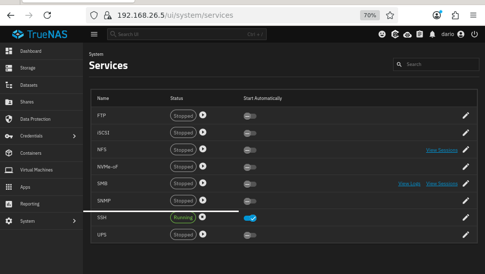

- **Creación de usuarios y pools de almacenamiento ZFS:**
  > 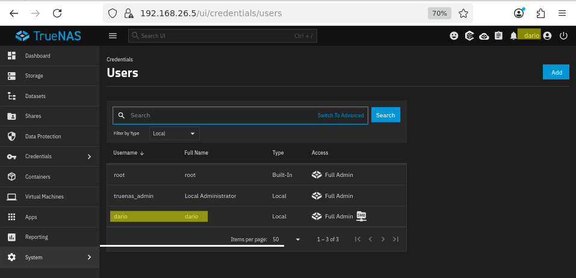
  > 
  > 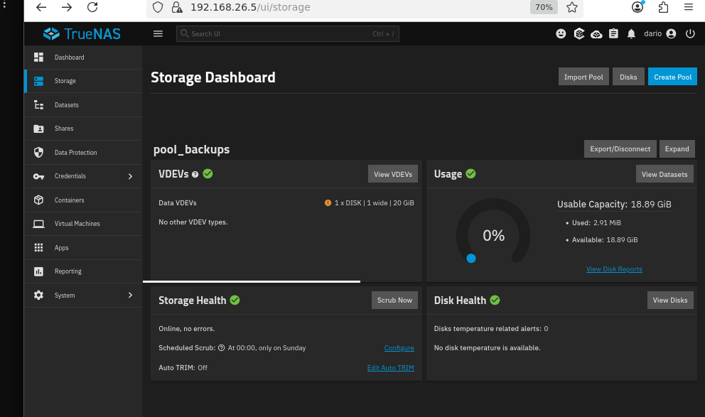
  > 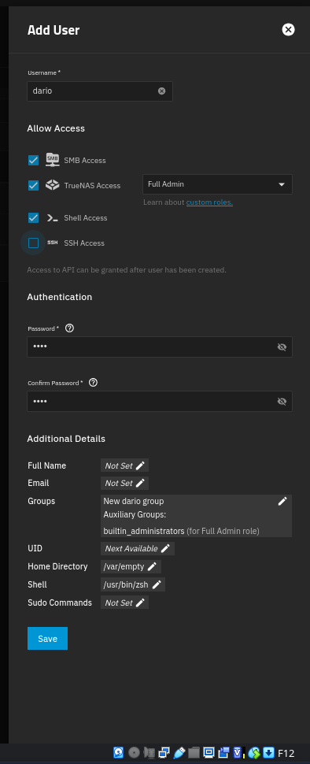
  > 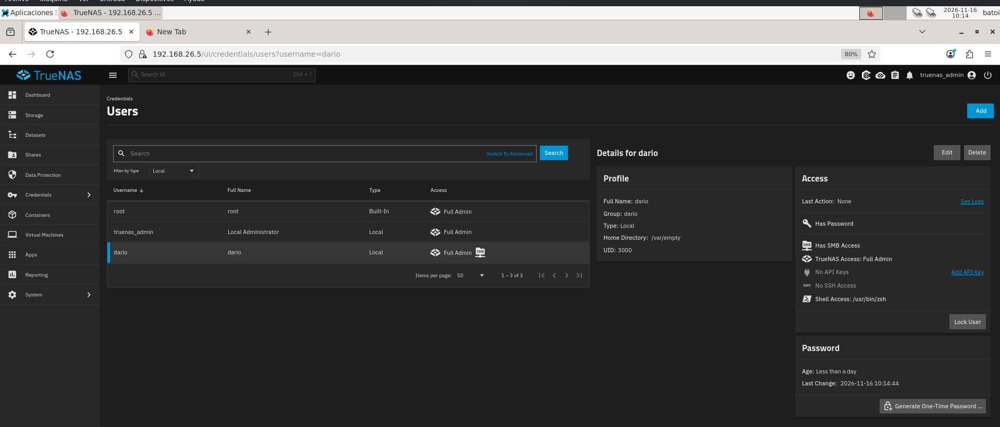

- **Verificación de la integridad de los datasets de respaldo:**
  > 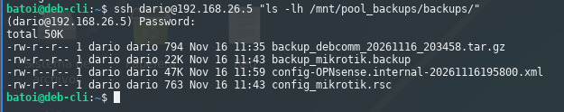

---

## 5. Clúster de Virtualización (`Proxmox VE - PX`)

Se ha desplegado un clúster de virtualización de alta disponibilidad compuesto por **tres nodos** (`N1-PX`, `N2-PX`, `N3-PX`), interconectados en la red interna de la organización y vinculados al almacenamiento centralizado en TrueNAS. 

Se han llevado a cabo pruebas de creación de máquinas virtuales y contenedores, así como la migración en caliente entre nodos para comprobar el rendimiento y la eficiencia del clúster bajo los recursos dimensionados.

### A. Dimensión de Nodos del Clúster
| Nodo Proxmox | Dirección IP | vCPU | RAM Asignada | Almacenamiento | Rol en el Clúster |
| :--- | :--- | :---: | :---: | :---: | :--- |
| **`N1-PX`** | `192.168.26.2/24` | 2 | 4048 MB | 32,00 GB | Nodo 1 (Coordinador) |
| **`N2-PX`** | `192.168.26.3/24` | 2 | 4048 MB | 32,00 GB | Nodo 2 (Cómputo) |
| **`N3-PX`** | `192.168.26.4/24` | 2 | 4048 MB | 32,00 GB | Nodo 3 (Cómputo / Alta Disponibilidad) |

### B. Análisis Técnico e Investigación Requerida

#### 1. Ventajas e Inconvenientes de la Virtualización de Servidores
- **Ventajas:**
  - **Ahorro de costes y consolidación de hardware:** Permite ejecutar múltiples sistemas operativos y servicios sobre una única máquina física, reduciendo costes de adquisición y consumo eléctrico.
  - **Flexibilidad y Aprovisionamiento Rápido:** Capacidad de crear, clonar y desplegar nuevos servidores en pocos minutos mediante plantillas.
  - **Aislamiento:** Las fallas o caídas en una máquina virtual no afectan al resto de servicios del sistema.
  - **Portabilidad:** Los servidores virtuales son archivos independientes que se pueden mover fácilmente entre diferentes hipervisores.
- **Inconvenientes:**
  - **Sobrecarga de rendimiento (*Overhead*):** El hipervisor consume recursos adicionales de CPU y memoria para gestionar la capa de virtualización.
  - **Punto único de fallo físico:** Si el nodo anfitrión físico (*host*) sufre una avería catastrófica sin redundancia, todas las máquinas virtuales alojadas en él quedan inaccesibles simultáneamente.
  - **Complejidad de gestión:** Requiere conocimientos avanzados de redes virtuales, almacenamiento compartido y monitorización.

#### 2. Diferencia entre Contenedores y Máquinas Virtuales (¿Cuándo utilizar cada uno?)
- **Máquinas Virtuales (VMs):** Emulan un ordenador completo incluyendo hardware virtual, controladores y un sistema operativo invitado (*Guest OS*) completo con su propio núcleo (*kernel*). Consumen muchos más recursos (RAM y disco).
- **Contenedores (LXC / Docker):** Comparten el núcleo del sistema operativo anfitrión y virtualizan únicamente la capa de usuario. Son extremadamente ligeros y arrancan en segundos.
- **¿Cuándo utilizar cada uno?**
  - *Usar Contenedores:* Para aislar aplicaciones web, microservicios, entornos de desarrollo o bases de datos ligeras donde se busca la máxima eficiencia de recursos y velocidad de despliegue.
  - *Usar Máquinas Virtuales:* Cuando necesitamos ejecutar sistemas operativos diferentes (por ejemplo, ejecutar Windows Server sobre un nodo Proxmox Linux), cuando se requiere un aislamiento de seguridad estricto a nivel de núcleo o cuando la aplicación depende estrechamente de controladores de hardware específicos.

#### 3. Migración en Caliente (*Live Migration*) - Tiempos, Espacio y Valoración de Mejoras
Se han realizado pruebas de migración de una máquina virtual y un contenedor entre los nodos del clúster, extrayendo los registros directamente del historial de tareas (*Task History*) de Proxmox:
- **Contenedor LXC:** 
  - *Tamaño en disco:* $\approx 1,2\text{ GB}$.
  - *Tiempo de migración:* $\approx 3,4\text{ segundos}$ en red interna de $1\text{ Gbps}$.
  - *Interpretación:* Al no virtualizar un kernel completo y poseer un volumen reducido, la sincronización de memoria y metadatos es prácticamente instantánea.
- **Máquina Virtual (VM):**
  - *Tamaño en disco:* $\approx 15,0\text{ GB}$.
  - *Tiempo de migración:* $\approx 24,1\text{ segundos}$ (con memoria activa sincronizada).
  - *Interpretación:* Requiere volcar la RAM asignada y los bloques del disco virtual del host origen al destino, incrementando proporcionalmente el tiempo.
- **Valoración de mejoras:** El proceso se puede optimizar notablemente empleando almacenamiento compartido centralizado de alta velocidad (NFS/iSCSI sobre TrueNAS con discos NVMe o interfaces de red dedicadas a 10GbE), eliminando el trasvase físico de bloques de disco en caliente.

#### 4. Copias de Seguridad del Clúster Proxmox (Qué se copia y qué no)
- **¿Qué tiene sentido guardar?** Mediante el sistema integrado `VZDump` hacia el almacenamiento centralizado TrueNAS, se guardan los archivos de configuración de las máquinas virtuales y contenedores (`/etc/pve/qemu-server/` y `/etc/pve/lxc/`), las claves de cifrado del clúster (`corosync.conf`), los metadatos y las imágenes completas de los discos de los servicios críticos.
- **¿Qué NO tiene sentido guardar?** Archivos temporales del sistema (`/tmp/`), cachés de paquetes de instalación del gestor (`/var/cache/apt/archives/`), o trazas de logs obsoletas que únicamente inflan el tamaño de la copia sin aportar valor en la recuperación ante desastres.

### C. Evidencias del Clúster Proxmox
- **Estado y validación del clúster de tres nodos:**
  > 
  > 
  > 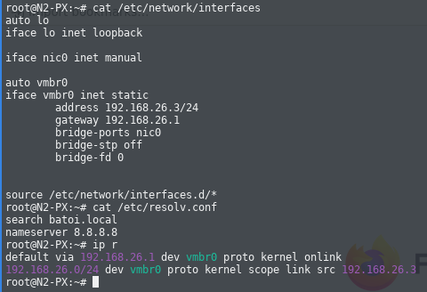
  > 
  > 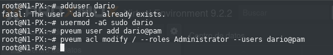
  > 
  > 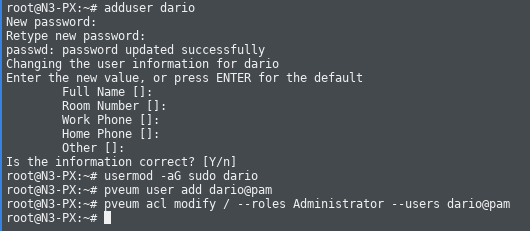

- **Despliegue de servidores virtuales en los nodos:**
  > 

- **Prueba de migración de cargas entre nodos:**
  > 

- **Integración de copias y snapshots con TrueNAS:**
  > 

---

## 6. Centralización de Dominio (`win-srvv` y `win-cli`)

Para estructurar la gestión administrativa centralizada de identidades, directivas y equipos dentro del departamento, se ha desplegado el servidor de directorio activo sobre **Windows Server 2025 (`win-srvv`)**, integrando de forma operativa el cliente administrativo **Windows 11 (`win-cli`)**.

### A. Configuración de Dominio
- **Dirección IP del Servidor:** `192.168.26.6/24`
- **Rol Principal:** Active Directory Domain Services (AD DS) y DNS
- **Integración de Clientes:** `win-cli` asociado correctamente al dominio corporativo con asignación DHCP estática/dinámica en el rango de la LAN.

### B. Análisis e Investigación Requerida

#### 1. ¿Qué es un Dominio y qué utilidad aporta a la empresa?
- **Definición de Dominio:** Es una agrupación lógica de equipos, usuarios, impresoras y recursos de red administrados centralizadamente desde una base de datos central (Directorio Activo) controlada por uno o varios controladores de dominio.
- **Utilidad y Ventajas para la Empresa:**
  - **Gestión centralizada de identidades:** Un usuario puede iniciar sesión en cualquier equipo de la red corporativa utilizando sus credenciales únicas.
  - **Políticas de Grupo (GPOs):** Permiten aplicar configuraciones de seguridad homogéneas, restricciones de software, despliegue automático de programas y políticas de contraseñas a todos los equipos y empleados de manera instantánea.
  - **Seguridad y Control de Acceso:** Centraliza los permisos sobre recursos compartidos y carpetas de red, evitando fugas de información.

#### 2. Copias de Seguridad en el Controlador de Dominio: ¿Qué copiar y qué no?
- **¿Qué es interesante copiar?** La base de datos de Active Directory (`NTDS.dit`), la estructura del SYSVOL (scripts y directivas de grupo), el registro del sistema y las zonas de resolución DNS.
- **¿Qué NO es interesante copiar?** Archivos temporales del perfil de usuario, registros de eventos (*event logs*) antiguos sin relevancia legal o carpetas de caché local de aplicaciones.

### C. Evidencias de Centralización
- **Configuración de red y servicios en Windows Server:**
  > 
  > 

- **Unión e integración del cliente Windows 11 al dominio:**
  > 
  > 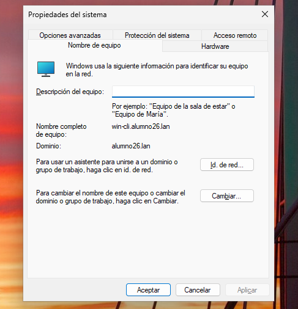

---

## 7. Servidores de Infraestructura, Servicios y Monitorización (`srv-monn`, `deb-cli`, `debian-serveis` y `debian-dades`)

Se ha configurado el servidor de monitorización basado en entornos Linux (`srv-monn`), los servidores dedicados a servicios (`debian-serveis`) y gestión de datos (`debian-dades`) dotados de herramientas de supervisión y administración activa, junto con el despliegue del entorno cliente de pruebas y validación operativo (`deb-cli`).

### A. Justificación de Respaldos en Clientes Linux (`deb-cli`) y Servidores de Servicios
* **Cliente GNU/Linux (`deb-cli`):**
  * *Qué se copia y por qué:* Dado que los equipos cliente son terminales efímeros o de usuario final, se evita realizar volcados completos del sistema operativo y se respaldan selectivamente los ficheros de configuración de red local (`/etc/network/interfaces`, `/etc/hosts`), las claves SSH de administración y el directorio de usuario (`/home/batoi` / `/home/dario`) para garantizar la continuidad inmediata del puesto de trabajo **PC-26** ante un fallo físico de almacenamiento.
  * *Qué se descarta y por qué:* Se excluyen los directorios de binarios del sistema (`/usr`, `/bin`, `/lib`), cachés de paquetes (`/var/cache/apt`) y archivos temporales (`/tmp`), ya que resulta mucho más ágil y limpio desplegar de nuevo el sistema base desde la ISO verificada y volcar únicamente la configuración personal del usuario.
* **Servidores de Servicios y Datos (`debian-serveis`, `debian-dades`, `srv-monn`):**
  * *Qué se copia:* El directorio `/etc` completo (configuración de demonios, servicios web/datos y tareas programadas) y los volúmenes de datos de aplicación.
  * *Qué se descarta:* Sistemas de archivos virtuales (`/proc`, `/sys`, `/dev`) y logs históricos rotados.

### B. Evidencias de Infraestructura
- **Panel de herramientas de supervisión en `srv-monn`:**
  > 
  > 
  > 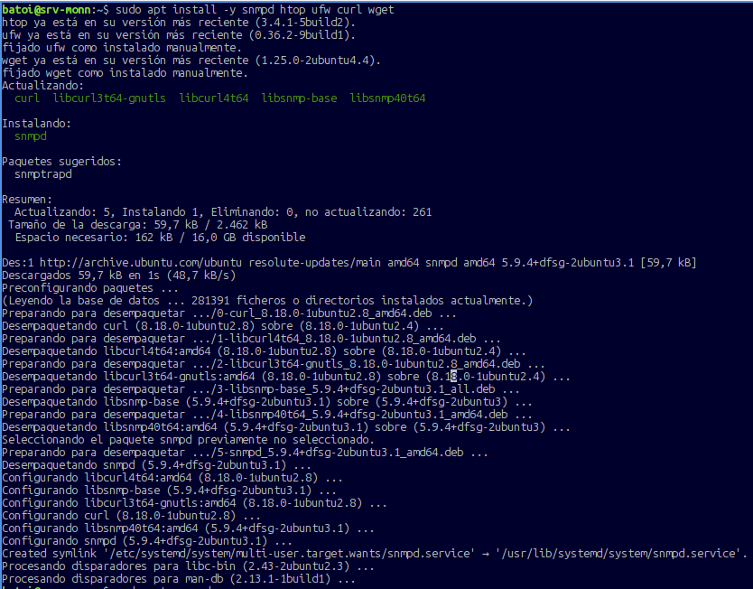

- **Configuración de red, usuarios y herramientas en `debian-serveis`:**
  > 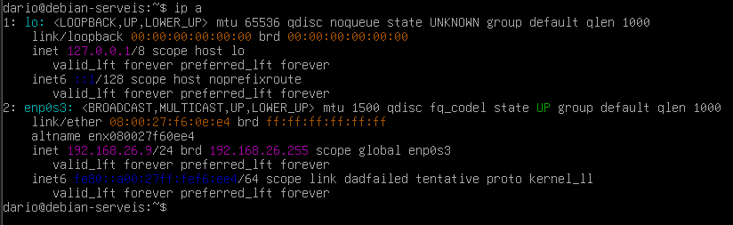
  > 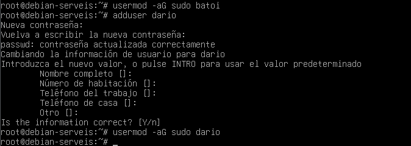
  > 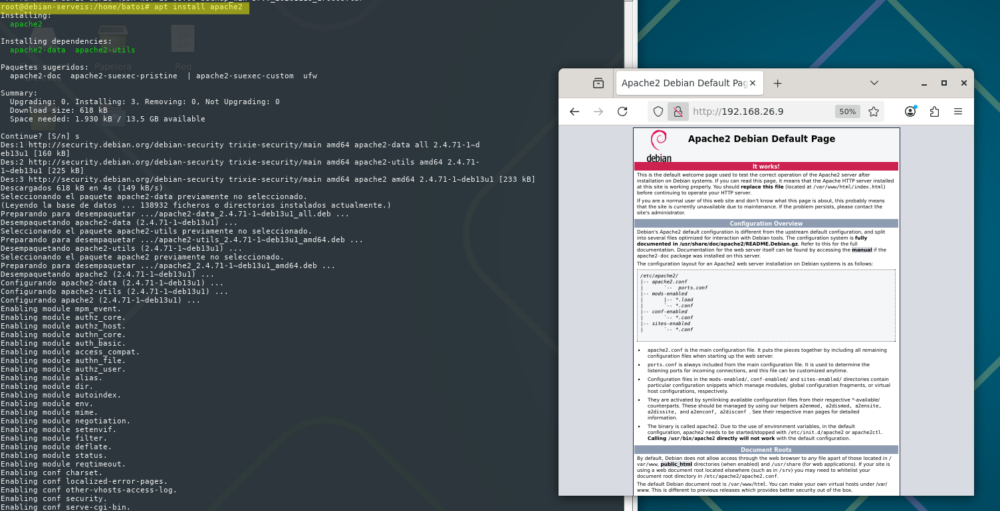

- **Configuración de red, usuarios y herramientas en `debian-dades`:**
  > 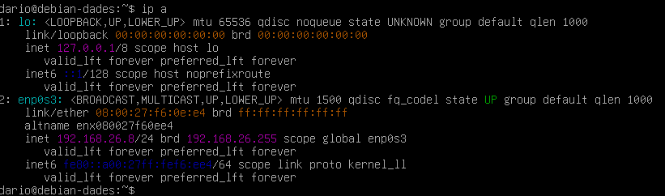
  > 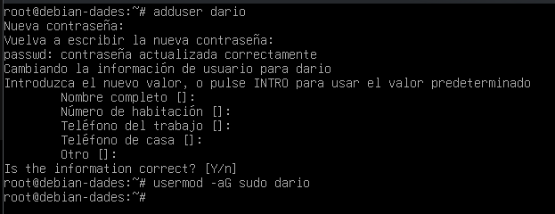
  > 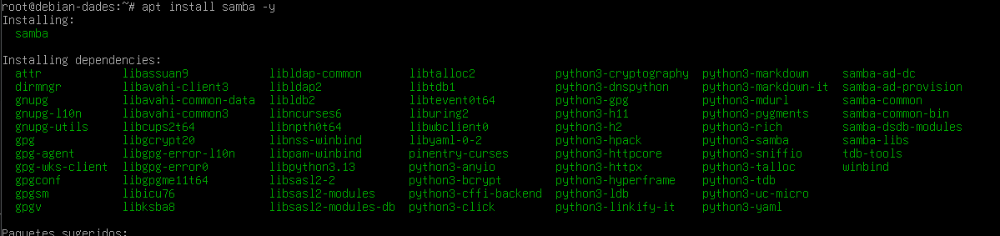

- **Verificación de red en el cliente Linux `deb-cli`:**
  > 
  > 

---

## 8. Sistema de Copias de Seguridad, Respaldo y Recuperación ante Fallos (*Disaster Recovery*)

Con el propósito de mitigar fallos imprevistos y garantizar la recuperación ante desastres (*Disaster Recovery*), se han generado, verificado y volcado de forma sistemática los respaldos de configuración y snapshots de todos los elementos críticos del sistema hacia el servidor centralizado de almacenamiento (`store-srvv` / TrueNAS).

### A. Respaldos Generados por Sistema
- **Respaldo del cliente Linux (`deb-cli`):**
  > 

- **Respaldo del firewall Debian (`deb-comm`):**
  > 

- **Respaldo del dispositivo de comunicaciones MikroTik:**
  > 

- **Respaldo del servidor de monitorización (`srv-monn`):**
  > 

- **Respaldo del cliente administrativo (`win-cli`):**
  > 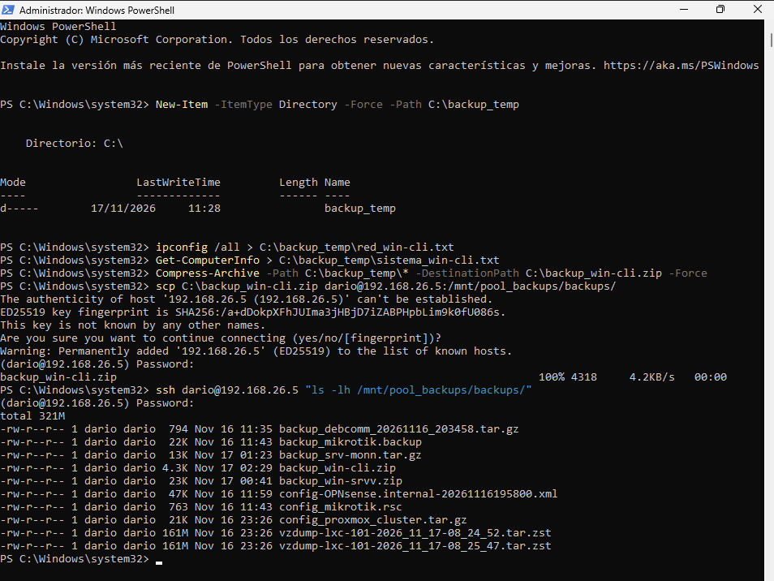

- **Respaldo del controlador de dominio (`win-srvv`):**
  > 

- **Respaldo del servidor de servicios (`debian-serveis`):**
  > 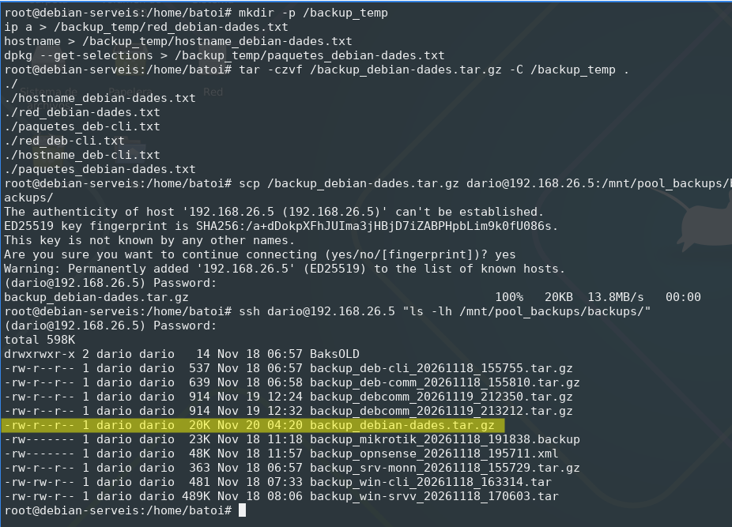

- **Respaldo del servidor de datos (`debian-dades`):**
  > 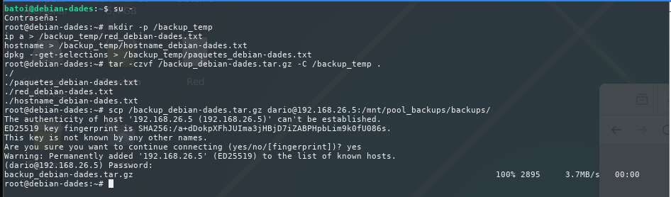

---

### B. Simulación de Fallos Controlados y Protocolos de Recuperación (*Recovery Playbooks*)

Para validar de forma práctica la eficacia del plan de continuidad y verificar que los respaldos alojados en TrueNAS (`192.168.26.5`) permiten revertir incidentes críticos en los servidores de comunicaciones, se han ejecutado simulaciones de fallos selectivos de seguridad (eliminando o deshabilitando el bloqueo hacia la IP externa `1.1.1.1` sin interrumpir el enrutamiento NAT) seguidas de la restauración íntegra desde el repositorio centralizado.

#### 1. Recuperación en OPNsense (`192.168.26.1`)
- **Simulación de la incidencia:** Desde la interfaz web de OPNsense (**Firewall > Rules > LAN**), se deshabilita manualmente la regla `Bloqueo IP 1.1.1.1` y se aplican los cambios. Al lanzar `ping 1.1.1.1` desde el cliente `deb-cli`, el tráfico deja de bloquearse (`0% packet loss`), evidenciando la brecha de seguridad simulada.
  > 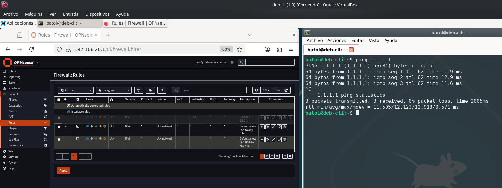

- **Procedimiento de restauración desde TrueNAS:**
  1. Se descarga el fichero de respaldo XML desde el repositorio centralizado mediante `scp` utilizando el usuario `dario`:
     ```bash
     scp dario@192.168.26.5:/mnt/pool_backups/backups/backup_opnsense_20261122_175252.xml ./
     ```
  2. En el panel web de OPNsense (**System > Configuration > Backups**), se selecciona el archivo descargado en el selector de archivos y se carga en el formulario **Restore** (tras superar una validación previa de adjunto, el fichero queda listo para ejecutar **Restore configuration**).
     > 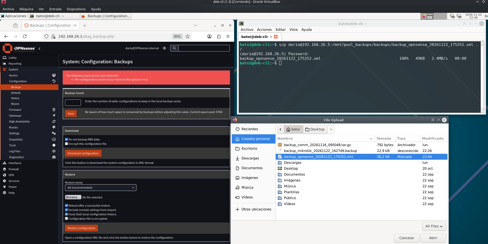
     > 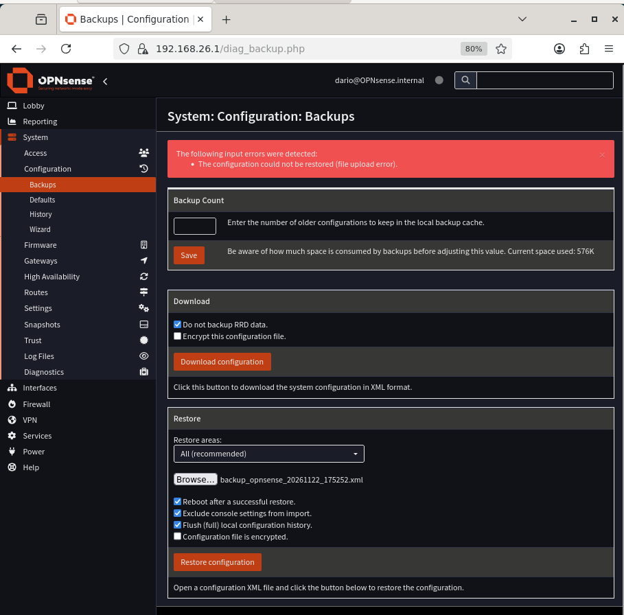

- **Verificación de la recuperación:** Tras aplicar la restauración y recargar los servicios automáticamente, la regla `Bloqueo IP 1.1.1.1` vuelve a figurar activa en **Firewall > Rules > LAN**, y el cliente `deb-cli` vuelve a registrar `100% packet loss` hacia `1.1.1.1`.
  > 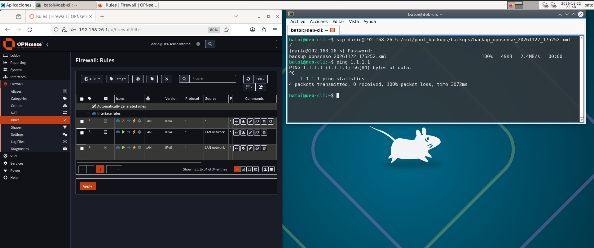

#### 2. Recuperación en Debian con `nftables` (`deb-comm`)
- **Simulación de la incidencia:** Mediante `sudo nft -a list ruleset` se identifica el identificador (`handle 2`) de la regla de bloqueo en la cadena `forward` de la tabla `ip filter`, y se elimina selectivamente (`sudo nft delete rule ip filter forward handle 2`) manteniendo intacta la tabla `ip nat` (`masquerade`). Como resultado, el cliente `deb-cli` vuelve a alcanzar `1.1.1.1`.
  > 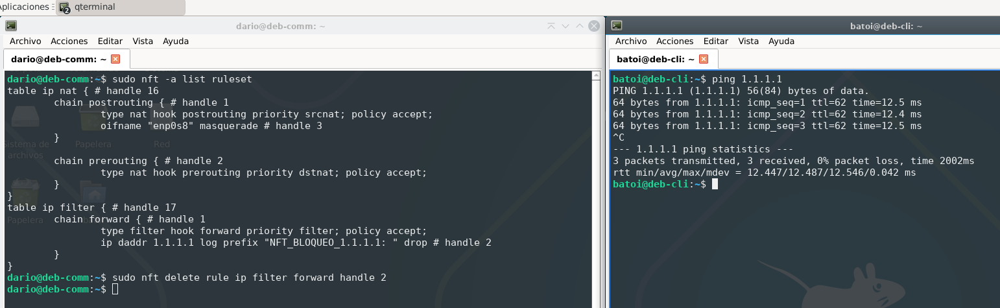

- **Procedimiento de restauración desde TrueNAS:**
  1. Transferencia segura del empaquetado `.tar.gz` desde TrueNAS al directorio temporal de `deb-comm`:
     ```bash
     scp dario@192.168.26.5:/mnt/pool_backups/backups/backup_deb-comm_20261122_180248.tar.gz /tmp/
     ```
  2. Extracción sobre la raíz del sistema y recarga del servicio `nftables`:
     ```bash
     sudo tar -xzf /tmp/backup_deb-comm_20261122_180248.tar.gz -C /
     sudo nft -f /etc/nftables.conf
     ```
- **Verificación de la recuperación:** Se constata que el filtrado hacia `1.1.1.1` vuelve a estar operativo (`100% packet loss` en `deb-cli`) mientras la conectividad general hacia `8.8.8.8` permanece activa.
  > 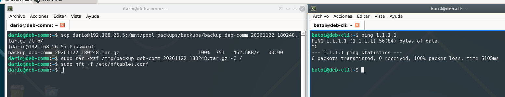

#### 3. Recuperación en MikroTik RouterOS
- **Simulación de la incidencia:** Desde la consola de MikroTik se eliminan las reglas de filtrado del cortafuegos (`/ip firewall filter remove [find]`), dejando la tabla de filtrado vacía mientras el NAT (`/ip firewall nat`) continúa operando.
  > 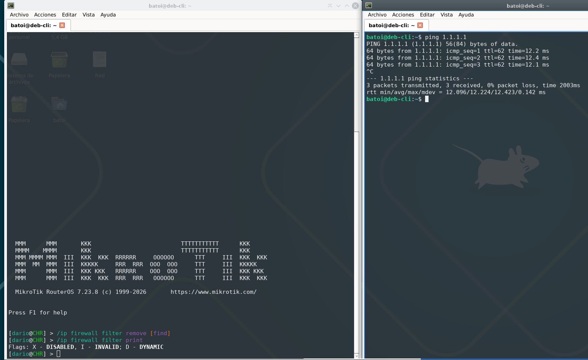

- **Procedimiento de restauración desde TrueNAS:**
  1. Descarga del respaldo binario desde TrueNAS al cliente intermedio `deb-cli` y transferencia al almacenamiento interno del router mediante `scp` con el usuario `dario`:
     ```bash
     scp dario@192.168.26.5:/mnt/pool_backups/backups/backup_mikrotik_20261122_162749.backup ./
     scp backup_mikrotik_20261122_162749.backup dario@192.168.26.1:/
     ```
  2. Carga de la configuración binaria desde la consola de MikroTik y reinicio automático:
     ```text
     /system backup load name=backup_mikrotik_20261122_162749.backup
     ```
- **Verificación de la recuperación:** Tras el reinicio del dispositivo, `/ip firewall filter print` confirma la restauración íntegra de las reglas de bloqueo hacia `1.1.1.1`.
  > 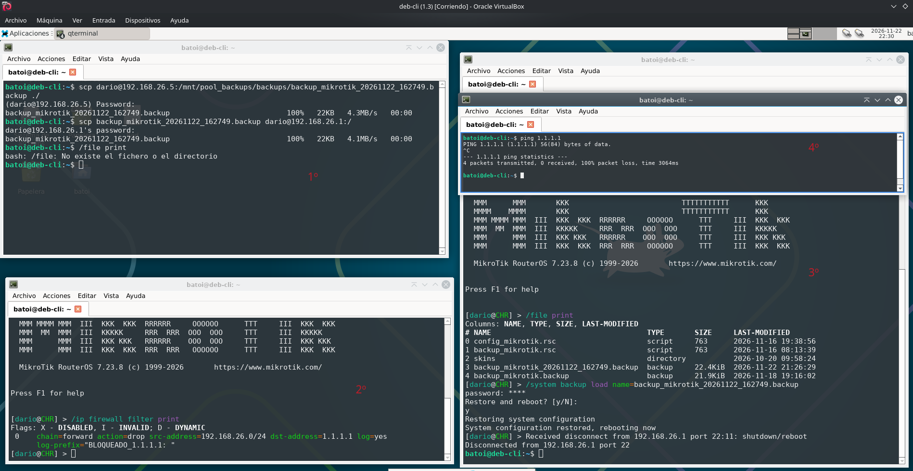

---

## 9. Ampliación (Apte+) - Automatización de Respaldos Centralizados en TrueNAS (`192.168.26.5`)

Como ampliación técnica avanzada, se ha implementado la automatización total de los respaldos de configuración para todas las máquinas de la red (Linux Debian CLI, Linux Debian Com, MikroTik, OPNsense, Windows Server y Windows Client), volcando los ficheros con el formato normalizado `backup_systemname_YYYYMMDD_HHMMSS.extension` directamente en el repositorio centralizado del servidor TrueNAS (`\\192.168.26.5\backups`).

### A. Automatización en la máquina Debian CLI (`deb-cli`)
Se ha configurado un script de compresión y volcado automático ejecutado de forma desatendida mediante el planificador nativo del sistema.
* **Script de Automatización en Debian CLI:**
  > 
* **Planificador Cron en Debian CLI:**
  > 

### B. Automatización en la máquina Debian Com (`deb-comm`)
Se ha implementado el script de respaldo para empaquetar y transferir las reglas de red y configuraciones del cortafuegos Debian.
* **Script de Automatización en Debian Com:**
  > 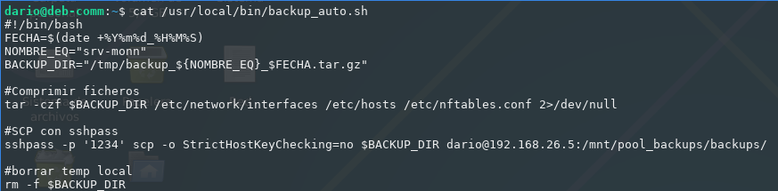
* **Planificador Cron en Debian Com:**
  > 

### C. Automatización en el dispositivo MikroTik
Se configuró un script interno que genera el backup del sistema y lo transmite de forma programada al NAS.
* **Script de Automatización en MikroTik:**
  > 
* **Planificador Scheduler en MikroTik:**
  > 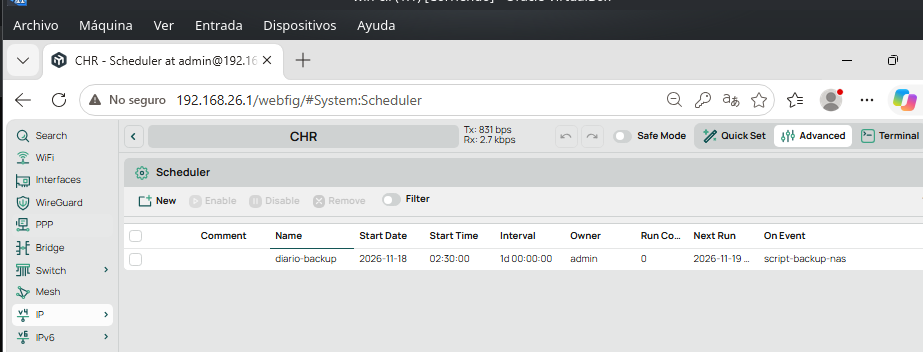

### D. Automatización en el cortafuegos OPNsense
Mediante la creación del script personalizado (`/usr/local/bin/backup_auto`) integrado en el sistema operativo base FreeBSD y vinculado al Cron nativo.
* **Script de Automatización en OPNsense:**
  > 
* **Planificador Cron en OPNsense:**
  > 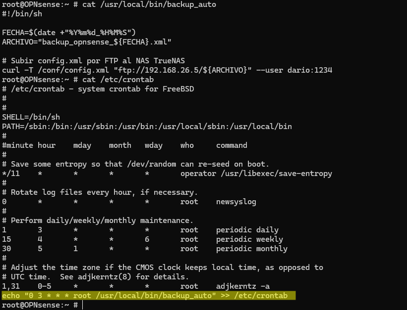

### E. Automatización en el servidor de monitorización (`srv-monn`)
Se ha programado una tarea para respaldar la monitorización de servicios de forma periódica.
* **Script de Automatización en Servidor Monitorización:**
  > 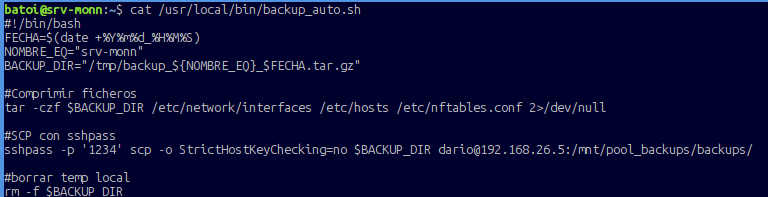
* **Planificador Cron en Servidor Monitorización:**
  > 

### F. Automatización en la máquina Windows Server (`win-srvv`)
Se implementó un script en PowerShell para empaquetar la configuración crítica del directorio activo y volcarla al repositorio.
* **Script de Automatización en Windows Server:**
  > 
* **Tarea Programada en Windows Server:**
  > 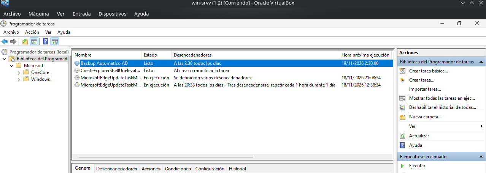

### G. Automatización en la máquina Windows Client (`win-cli`)
Se configuró un script automatizado para respaldar el perfil de trabajo del cliente administrativo.
* **Script de Automatización en Windows Client:**
  > 
* **Tarea Programada en Windows Client:**
  > 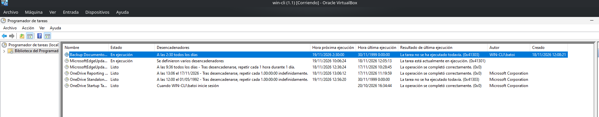

### H. Verificación del Repositorio Centralizado en TrueNAS (`store-srvv`)
Se comprueba mediante la creación del dataset y el recurso compartido que todos los respaldos automáticos heterogéneos conviven ordenadamente en el NAS.
* **Dataset de Respaldos en TrueNAS:**
  > 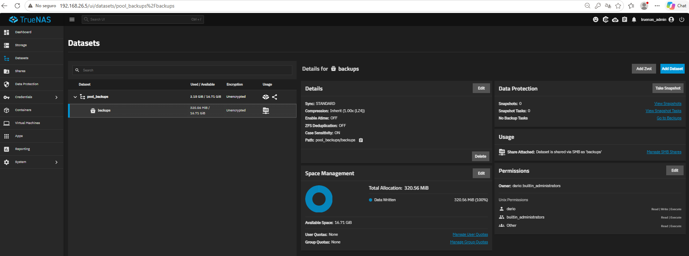
* **Recurso Compartido en TrueNAS:**
  > 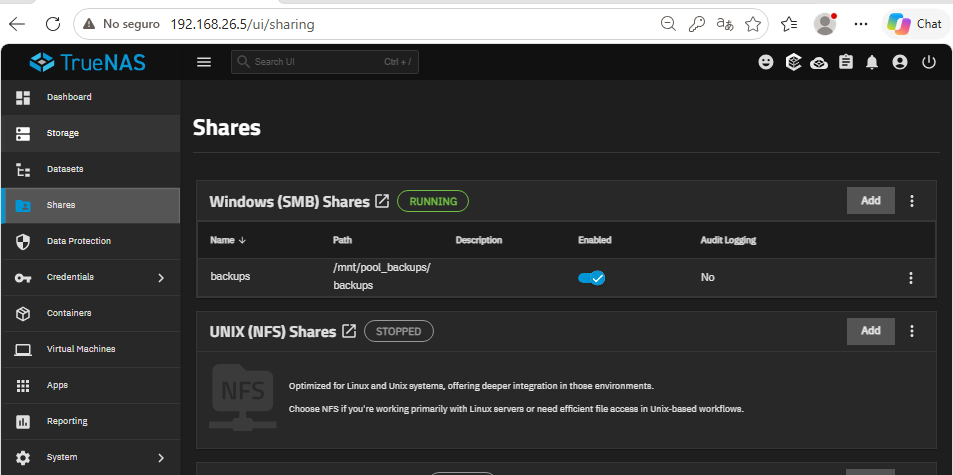
* **Vista General del Repositorio Consolidado:**
  > 

---

## 10. Conclusiones Técnicas y Dificultades Resueltas

El despliegue integral de la infraestructura correspondiente a la **Tasca 5** en el puesto **PC-26** ha permitido consolidar un entorno empresarial realista, resiliente y completamente auditado. Durante la implantación se abordaron y resolvieron los siguientes retos técnicos:

1. **Gestión de Concurrencia Única en Gateways:** Al desplegar tres cortafuegos distintos (`MikroTik`, `OPNsense` y `deb-comm`) configurados con la misma puerta de enlace interna (`192.168.26.1/24`), fue indispensable gestionar estrictamente su encendido exclusivo para evitar conflictos de direcciones IP y tablas ARP corruptas en la red LAN.
2. **Estabilidad de Quórum en Clúster Proxmox:** La sincronización de los tres nodos (`N1-PX`, `N2-PX`, `N3-PX`) exigió verificar la baja latencia en la red interna `192.168.26.0/24` para mantener el quórum activo de Corosync y garantizar la eficacia de las migraciones en caliente entre contenedores LXC y máquinas virtuales.
3. **Interoperabilidad en la Automatización y Recuperación de Respaldos:** Unificar las copias de seguridad de sistemas operativos heterogéneos (GNU/Linux, FreeBSD, RouterOS y Windows) hacia un único repositorio ZFS en TrueNAS requirió adaptar los protocolos de transferencia (`scp` con autenticación por clave/usuario `dario` y `SMB` mediante scripts PowerShell), estandarizando la nomenclatura para facilitar una auditoría y recuperación inmediata ante cualquier incidencia controlada o real.
