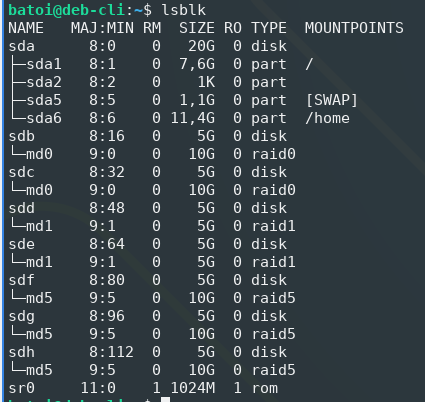
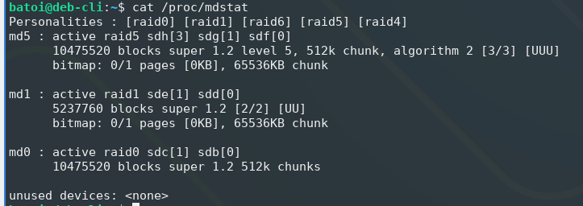
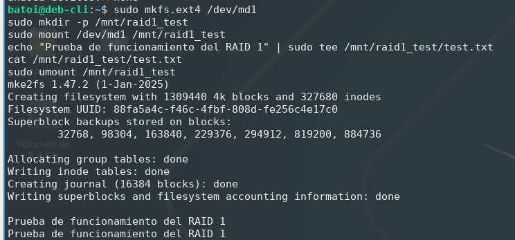

# Almacenamiento Avanzado y Tolerancia a Fallos (RAID) - Tasca 6 (ASIX ThinkLab)

| Datos de Configuración | Detalle |
| :--- | :--- |
| **Alumno** | Darío Martiáñez Pérez |
| **Número de PC** | PC-26 |
| **Red Interna (LAN)** | `192.168.26.0/24` |
| **Módulos** | ISO / FDM |

---

## 1. Introducción y Objetivos de la Tasca 6

El presente documento recoge el diseño, implementación y verificación de soluciones de almacenamiento redundante mediante **RAID por software (`mdadm`)** sobre el cliente de pruebas **Debian (`deb-cli`)** del entorno individualizado, adaptado al puesto **PC-26**.

El objetivo principal es comprender el funcionamiento práctico de los distintos niveles de RAID (0, 1 y 5), analizar el compromiso entre rendimiento, capacidad útil y tolerancia a fallos, y garantizar la persistencia y montaje automático de los volúmenes tras el reinicio del sistema.

---

## 2. Preparación de Discos Virtuales y Estructura de Bloques

Para llevar a cabo las prácticas sobre el cliente `deb-cli`, se han añadido discos virtuales adicionales dedicados a la construcción de los arrays RAID. 

### A. Esquema de Discos Asignados (`lsblk`)
| Dispositivo Físico | Tamaño Total | Dispositivo RAID Asociado | Nivel RAID | Estado |
| :--- | :---: | :--- | :--- | :--- |
| **`/dev/sdb`, `/dev/sdc`** | 5,00 GB c/u | `/dev/md0` | RAID 0 (Striping) | Activo |
| **`/dev/sdd`, `/dev/sde`** | 5,00 GB c/u | `/dev/md1` | RAID 1 (Mirroring) | Activo |
| **`/dev/sdf`, `/dev/sdg`, `/dev/sdh`** | 5,00 GB c/u | `/dev/md5` | RAID 5 (Paridad) | Activo |

### B. Evidencias de Estructura de Discos (`lsblk`)
> 

---

## 3. Implementación y Verificación de Niveles RAID (`mdadm`)

A continuación se detalla la creación, estado de sincronización y pruebas de formato y montaje de los volúmenes RAID desplegados:

### A. Estado General de los Arrays (`/proc/mdstat`)
Mediante la lectura del archivo del núcleo `/proc/mdstat`, se verifica que los tres niveles (`md0` de tipo RAID 0, `md1` de tipo RAID 1 y `md5` de tipo RAID 5) se encuentran activos y sincronizados correctamente con sus respectivos discos integrantes:
> 

### B. Pruebas de Formateo, Montaje y Escritura (`ext4`)
Se ha procedido al formateo de los dispositivos bajo el sistema de ficheros `ext4`, su montaje en directorios de prueba temporales y la verificación de lectura/escritura de ficheros de texto. A modo de ejemplo, se muestra el proceso completo sobre el dispositivo RAID 1 (`/dev/md1`):
> 

---

## 4. Análisis Técnico e Investigación Requerida

### A. Comparativa Teórica de Niveles RAID
* **RAID 0:** Maximiza la velocidad de lectura/escritura dividiendo los bloques entre los discos disponibles, pero carece de tolerancia a fallos. Si un disco falla, se pierde toda la información del array.
* **RAID 1:** Duplica exactamente los datos entre dos o más discos (*mirroring*). Ofrece alta seguridad y permite recuperar el sistema ante la rotura de un disco completo, sacrificando el 50% de la capacidad de almacenamiento.
* **RAID 5:** Distribuye la paridad entre todos los discos del array (mínimo 3). Ofrece un excelente equilibrio entre rendimiento, capacidad útil y tolerancia ante el fallo de un (1) disco sin pérdida de datos.

### B. RAID por Software vs. RAID por Hardware
* **RAID Software (`mdadm`):** Gestionado íntegramente por el núcleo del sistema operativo. Destaca por su flexibilidad, bajo coste y portabilidad de los discos a cualquier otro equipo con Linux, aunque consume recursos de la CPU principal para calcular la paridad.
* **RAID Hardware:** Utiliza una tarjeta controladora dedicada con su propio procesador y memoria caché protegida por batería. Libera de carga al sistema operativo, pero presenta un coste elevado y dependencia directa del hardware del fabricante.

---

## 5. Ampliación (Apte+) - RAID en Espejo entre Equipos Diferentes (*Network RAID*)

> **Estado Actual:** *PENDIENTE / EN CURSO*  
> **Planificación:** Apartado reservado para documentar la implementación y pruebas de tolerancia a fallos del **RAID 1 en red entre dos equipos diferentes** mediante **NBD (*Network Block Device*) + `mdadm`**, incluyendo la justificación de su caso de uso en Alta Disponibilidad y las evidencias de configuración (`nbd-server`, `nbd-client` y `/dev/md_net`).
