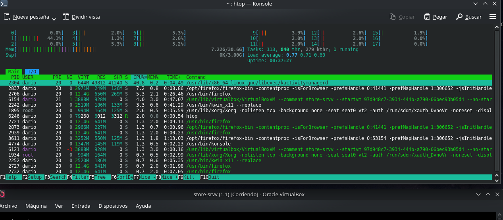

# Análisis de Rendimiento y Diagnóstico - Tasca 7 (ASIX ThinkLab)

| Datos de Configuración | Detalle |
| :--- | :--- |
| **Alumno** | Darío Martiáñez Pérez |
| **Número de PC** | PC-26 |
| **Red Interna (LAN)** | `192.168.26.0/24` |
| **Módulos** | ISO / FDM |

---

## 1. Descripción del Entorno y Metodología

El objetivo de esta actividad es evaluar el consumo de recursos físicos del equipo anfitrión (*host*) (**PC-26**, dotado con procesador Intel Core Ultra 5 125H de 14 núcleos / 18 hilos y $30,6\text{ GiB}$ de memoria RAM disponible) bajo distintos escenarios de carga de virtualización en **VirtualBox**.

Para ello, se han llevado a cabo tres fases de medición empírica utilizando comandos nativos de Linux (`free -h`, `top` y `htop`):
1. **Línea base en reposo:** Consumo nativo del host sin máquinas virtuales activas.
2. **Aislamiento de carga:** Impacto individual al ejecutar una única VM exigente (`store-srvv`).
3. **Concurrencia y saturación:** Encendido simultáneo progresivo de las máquinas virtuales del proyecto hasta evaluar el umbral operativo.

---

## 2. Análisis Comparativo de Recursos del Host

A continuación se presenta la tabla comparativa con las métricas reales obtenidas en cada escenario de prueba:

| Métrica del Host | Escenario 1: Reposo (Línea Base) | Escenario 2: VM Aislada (`store-srvv`) | Escenario 3: Concurrencia (9 VMs activas) |
| :--- | :---: | :---: | :---: |
| **Máquinas Virtuales Activas** | `0` | `1` (`store-srvv` - TrueNAS) | `9` (`N1-PX`, `N2-PX`, `N3-PX`, `MikroTik`, `win-srvv`, `store-srvv`, `srv-monn`, `deb-cli`, `win-cli`) |
| **Memoria RAM Usada** | $3,3\text{ GiB} / 30\text{ GiB}$ ($11\%$) | $7,22\text{ GiB} / 30,6\text{ GiB}$ ($23,6\%$) | $23,7\text{ GiB} / 30,6\text{ GiB}$ ($77,5\%$) |
| **Memoria RAM Disponible** | $27\text{ GiB}$ | $23,38\text{ GiB}$ | $6,9\text{ GiB}$ |
| **Uso de Memoria Swap** | $0\text{ B} / 3,0\text{ GiB}$ | $0\text{ K} / 3,00\text{ GiB}$ | $0\text{ K} / 3,00\text{ GiB}$ |
| **Carga Media CPU (*Load Average*)** | `0.70, 0.43, 0.31` | `0.77, 0.71, 0.60` | `2.76, 1.62, 0.97` |
| **Porcentaje CPU en Reposo (`id`)** | $98,5\%$ libre | $\approx 90\%$ libre (picos puntuales en hilo 1) | $\approx 85\% - 90\%$ libre (carga repartida en 18 hilos) |

---

## 3. Evidencias de Ejecución por Escenario

### A. Línea Base en Reposo (`0` VMs)
El sistema operativo anfitrión arrancado desde el SSD externo mantiene un consumo base muy reducido ($3,3\text{ GiB}$ de RAM y más del $98\%$ de CPU inactiva), dejando prácticamente la totalidad de los recursos libres para la hipervisión.

---

### B. Impacto Individual por Máquina Virtual (`store-srvv`)
Al encender de forma aislada la máquina **TrueNAS SCALE (`store-srvv`)**, la memoria RAM consumida en el host asciende de $3,3\text{ GiB}$ a **$7,22\text{ GiB}$** ($+3,92\text{ GiB}$ de incremento neto). Se confirma que el almacenamiento basado en ZFS y servicios de red demanda un bloque elevado de memoria física desde el inicio, mientras que el impacto en procesador se mantiene muy bajo (*load average* de `0.77`).

---

### C. Prueba de Concurrencia y Límite Operativo (`9` VMs simultáneas)
Se procedió a arrancar de forma simultánea **9 máquinas virtuales** del laboratorio: los tres nodos del clúster Proxmox (`N1-PX`, `N2-PX`, `N3-PX`), el router `MikroTik`, los servidores `win-srvv`, `store-srvv` y `srv-monn`, además de los dos clientes (`deb-cli` y `win-cli`).

---

## 4. Diagnóstico de Saturación y Conclusiones Técnicas

A partir de las métricas recopiladas durante las pruebas en el **PC-26**, se extraen las siguientes conclusiones:

1. **Recurso crítico que se satura primero (Memoria RAM):**
   - La **memoria RAM** es el principal cuello de botella del sistema. Mientras que los 18 hilos del procesador Intel Core Ultra 5 absorben con holgura la carga de 9 máquinas virtuales simultáneas (manteniendo un *load average* de `2.76` sobre una capacidad teórica de `18.00`), el consumo de RAM escala rápidamente hasta alcanzar los **$23,7\text{ GiB}$ de $30,6\text{ GiB}$** ($77,5\%$).
2. **Máquinas virtuales más exigentes por recurso:**
   - **Mayor consumo de RAM:** `store-srvv` (TrueNAS SCALE, con $8048\text{ MB}$ asignados), `win-cli` (Windows 11, consumiendo el $8,1\%$ de la RAM total del host en `htop`) y el conjunto del clúster Proxmox (`N1-PX`, `N2-PX`, `N3-PX` con $4048\text{ MB}$ cada uno).
   - **Mayor consumo de CPU:** Los nodos de virtualización `N1-PX` ($9,2\%$) y `N3-PX` ($6,6\%$), seguidos por el servidor de monitorización `srv-monn` ($6,3\%$) y `win-srvv` ($6,2\%$).
3. **Límite máximo de máquinas concurrentes sin bloqueo:**
   - En el equipo del aula (**PC-26** con $32\text{ GB}$ de RAM), es posible mantener **9 máquinas virtuales operativas de forma simultánea** sin que el sistema recurra a la partición *Swap* (`0K/3.00G`) ni sufra bloqueos. Con los $6,9\text{ GiB}$ restantes podría arrancarse una décima máquina ligera (como `deb-comm`), pero encender el total de las 11 VMs (incluyendo `OPNSense` con $3\text{ GB}$) superaría el umbral seguro y forzaría paginación en disco.
   - *Nota comparativa:* En el equipo de casa ($16\text{ GB}$ de RAM) o en equipos limitados a $8\text{ GB}$, el límite operativo se reduce drásticamente a **2 o 3 máquinas simultáneas** dependiendo de si se incluye Windows o TrueNAS.

---

## 5. Ampliación: Propuestas de Optimización (Apte+) — *Pendiente de realizar*

> **Estado:** *Sección planificada y pendiente de ejecución y captura de evidencias.*

Para alcanzar los objetivos de ampliación (Apte+) y reducir la huella de memoria RAM detectada en la prueba de concurrencia, se aplicarán y medirán próximamente las siguientes **dos optimizaciones** en la configuración de VirtualBox:

1. **Optimización 1 — Reajuste de asignación de vRAM en servidores Linux y TrueNAS:**
   - **Acción prevista:** Reducir la memoria asignada a `store-srvv` de $8048\text{ MB}$ a $4096\text{ MB}$ (suficiente para entorno de pruebas sin deduplicación ZFS activa) y ajustar los nodos Proxmox (`N1-PX`, `N2-PX`, `N3-PX`) de $4048\text{ MB}$ a $3072\text{ MB}$.
   - **Mejora esperada:** Liberar aproximadamente **$7\text{ GiB}$ de RAM física** en el host, permitiendo arrancar el laboratorio completo sin riesgo de paginación.
2. **Optimización 2 — Desactivación de entornos gráficos y servicios innecesarios en arranque:**
   - **Acción prevista:** Configurar el arranque en modo texto (`multi-user.target`) en `srv-monn` (Lubuntu) y deshabilitar servicios en segundo plano no utilizados en `win-srvv` y `win-cli`.
   - **Mejora esperada:** Disminuir tanto el consumo base de memoria residente (`RES`) como los ciclos de CPU en reposo de dichas VMs.

### Evidencias pendientes de adjuntar tras aplicar las mejoras:
- [ ] Tabla comparativa *Antes vs. Después* de las optimizaciones.
- [ ] Captura de `htop` con las 9-10 VMs activas tras el reajuste de recursos (`../evidencias/t7-apte_host_optimizado.png`).
