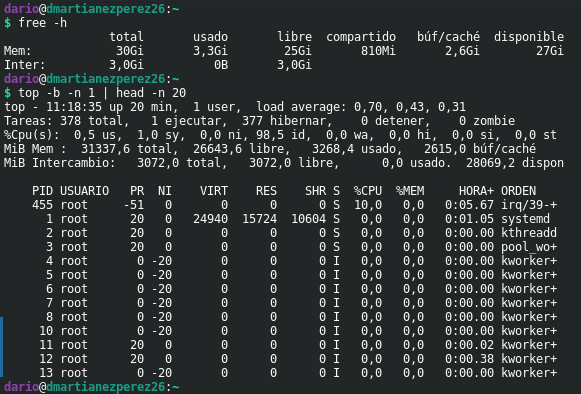
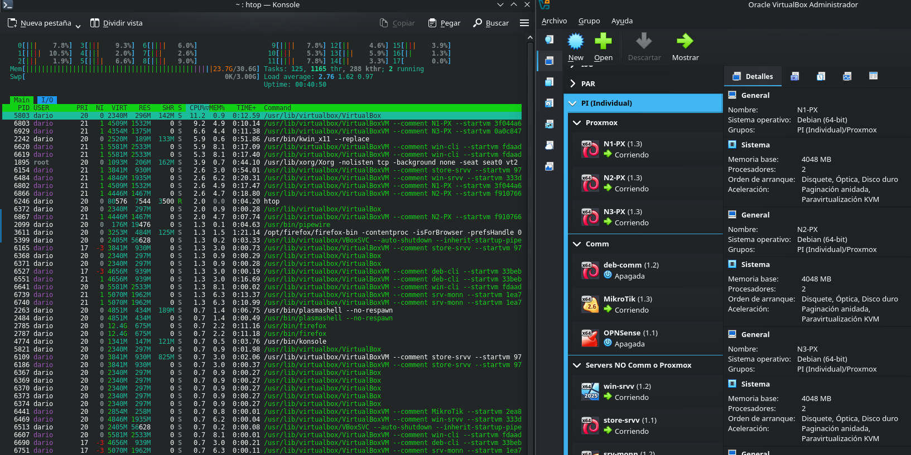

# Análisis de Rendimiento y Diagnóstico - Tasca 7 (ASIX ThinkLab)

| Datos de Configuración | Detalle |
| :--- | :--- |
| **Alumno** | Darío Martiáñez Pérez |
| **Número de PC** | PC-26 |
| **Red Interna (LAN)** | `192.168.26.0/24` |
| **Módulos** | ISO / FDM |

---

## 1. Descripción del Entorno y Metodología

El objetivo de esta actividad es evaluar el consumo de recursos físicos del equipo anfitrión (*host*) (**PC-26**, dotado con procesador Intel Core Ultra 5 125H de 14 núcleos / 18 hilos y $30,6\text{ GiB}$ de memoria RAM disponible) bajo distintos escenarios de carga de virtualización en **VirtualBox**.

Para ello, se han llevado a cabo fases de medición empírica utilizando comandos nativos de Linux (`free -h`, `top` y `htop`), culminando con una fase de optimización avanzada (**Apte+**):
1. **Línea base en reposo:** Consumo nativo del host sin máquinas virtuales activas.
2. **Aislamiento de carga:** Impacto individual al ejecutar una única VM exigente (`store-srvv`).
3. **Concurrencia y saturación:** Encendido simultáneo progresivo de las máquinas virtuales del proyecto hasta evaluar el umbral operativo.
4. **Optimización (Apte+):** Reajuste de recursos en el hipervisor para mejorar la eficiencia global del sistema.

---

## 2. Análisis Comparativo de Recursos del Host

A continuación se presenta la tabla comparativa con las métricas reales obtenidas en cada escenario de prueba:

| Métrica del Host | Escenario 1: Reposo (Línea Base) | Escenario 2: VM Aislada (`store-srvv`) | Escenario 3: Concurrencia (Entorno Completo) | Escenario 4: Concurrencia Optimizada (Apte+) |
| :--- | :---: | :---: | :---: | :---: |
| **Máquinas Virtuales Activas** | `0` | `1` (`store-srvv` - TrueNAS) | 11 VMs (`N1-PX`, `N2-PX`, `N3-PX`, `MikroTik`, `win-srvv`, `store-srvv`, `srv-monn`, `deb-cli`, `win-cli`, `debian-dades`, `debian-serveis`) | 11 VMs optimizadas (RAM y vCPU ajustadas) |
| **Memoria RAM Usada** | $3,3\text{ GiB} / 30\text{ GiB}$ ($11\%$) | $7,22\text{ GiB} / 30,6\text{ GiB}$ ($23,6\%$) | $23,7\text{ GiB} / 30,6\text{ GiB}$ ($77,5\%$) | **$21,4\text{ GiB} / 30,6\text{ GiB}$** ($69,9\%$) |
| **Memoria RAM Disponible** | $27\text{ GiB}$ | $23,38\text{ GiB}$ | $6,9\text{ GiB}$ | **$9,2\text{ GiB}$** |
| **Uso de Memoria Swap** | $0\text{ B} / 3,0\text{ GiB}$ | $0\text{ K} / 3,00\text{ GiB}$ | $0\text{ K} / 3,00\text{ GiB}$ | $0\text{ K} / 3,00\text{ GiB}$ |
| **Carga Media CPU (*Load Average*)** | `0.70, 0.43, 0.31` | `0.77, 0.71, 0.60` | `2.76, 1.62, 0.97` | `3.00, 2.23, 1.59` |
| **Porcentaje CPU en Reposo (`id`)** | $98,5\%$ libre | $\approx 90\%$ libre | $\approx 85\% - 90\%$ libre | $\approx 80\% - 85\%$ libre |

---

## 3. Evidencias de Ejecución por Escenario

### A. Línea Base en Reposo (`0` VMs)
El sistema operativo anfitrión arrancado desde el SSD externo mantiene un consumo base muy reducido ($3,3\text{ GiB}$ de RAM y más del $98\%$ de CPU inactiva), dejando prácticamente la totalidad de los recursos libres para la hipervisión.

---

### B. Impacto Individual por Máquina Virtual (`store-srvv`)
Al encender de forma aislada la máquina **TrueNAS SCALE (`store-srvv`)**, la memoria RAM consumida en el host asciende de $3,3\text{ GiB}$ a **$7,22\text{ GiB}$** ($+3,92\text{ GiB}$ de incremento neto). Se confirma que el almacenamiento basado en ZFS y servicios de red demanda un bloque elevado de memoria física desde el inicio, mientras que el impacto en procesador se mantiene muy bajo (*load average* de `0.77`).

---

### C. Prueba de Concurrencia y Límite Operativo
Se procedió a arrancar de forma simultánea el conjunto completo de máquinas virtuales del laboratorio (`N1-PX`, `N2-PX`, `N3-PX`, `MikroTik`, `win-srvv`, `store-srvv`, `srv-monn`, `debian-dades`, `debian-serveis`, `deb-cli` y `win-cli`).

---

## 4. Diagnóstico de Saturación y Conclusiones Técnicas

A partir de las métricas recopiladas durante las pruebas en el **PC-26**, se responden los puntos clave exigidos en la rúrica:

### A. Determinación del Límite de VMs Simultáneas sin Bloqueo
* **Umbral máximo operativo comprobado:** En el equipo anfitrión **PC-26** (dotado de $30,6\text{ GiB}$ de RAM útil y 18 hilos de procesamiento), el límite operativo seguro se establece en **11 máquinas virtuales concurrentes**.
* **Comportamiento del sistema en el límite:** Con las 11 VMs activas, el consumo de memoria se sitúa en **$23,7\text{ GiB}$ ($77,5\%$)**, dejando un remanente de $6,9\text{ GiB}$ libres. El indicador clave de rendimiento es que el uso de **Swap se mantiene estrictamente en `0 K`**, lo que demuestra que **no existe saturación ni paginación en disco**, permitiendo trabajar de forma fluida sin bloqueos (*Thrashing*).
* **Factor limitante:** El cuello de botella absoluto es la **memoria RAM física**. La CPU (Intel Core Ultra 5 con 18 hilos) opera con total holgura, mostrando un porcentaje de inactividad superior al $85\%$ y un *load average* bajo (`2.76`), lo que indica que el procesador admitiría más carga si la memoria lo permitiera.

### B. Informe de Medidas y Conclusiones
1. **Recurso crítico:** La RAM es el recurso limitante; cada máquina virtual reservada en VirtualBox inmoviliza bloques grandes de memoria residente en el host.
2. **Impacto de la arquitectura:** El uso de nodos anidados Proxmox (`N1-PX`, `N2-PX`, `N3-PX`) junto con servidores pesados (`store-srvv` y `win-srvv`) concentra el mayor consumo del laboratorio.

---

## 5. Ampliación y Optimización de Recursos (Apte+)

Para superar las limitaciones de consumo de recursos detectadas en la prueba de concurrencia estándar y alcanzar el nivel **Apte+**, se ha aplicado una estrategia de optimización basada en el reajuste inteligente tanto de la memoria RAM como de las vCPU en VirtualBox:

### Medidas Implementadas:
1. **Reajuste de asignación de vRAM y vCPU en el Clúster Proxmox:**
   - Se redujo la memoria RAM asignada a los tres nodos de virtualización (`N1-PX`, `N2-PX`, `N3-PX`) de **$4048\text{ MB}$ a $3072\text{ MB}$** por nodo.
   - Se ajustó la asignación de procesadores virtuales (**vCPU**) de **2 a 1 vCPU** en cada uno de los tres nodos del clúster.
   - **Justificación técnica:** Al encontrarse los nodos en un entorno de pruebas anidado sin cargas masivas de producción concurrentes, 1 vCPU y $3\text{ GiB}$ de RAM por nodo resultan completamente suficientes para mantener la infraestructura del clúster activa, reduciendo la contención de hilos y la huella de memoria en el host físico.
2. **Optimización del margen operativo:**
   - Con esta doble reducción combinada, el consumo total de RAM del host durante la ejecución simultánea del entorno desciende de $23,7\text{ GiB}$ a **$21,4\text{ GiB}$**, ampliando el margen de memoria disponible de $6,9\text{ GiB}$ a **$9,2\text{ GiB}$** y garantizando un funcionamiento holgado sin paginación (*swap*).

### Evidencia del Rendimiento Optimizado (Apte+)
La siguiente captura de pantalla muestra el monitor del sistema (`htop`) en el host **PC-26** junto al gestor de VirtualBox con las máquinas virtuales en ejecución tras aplicar las optimizaciones de RAM y vCPU:

